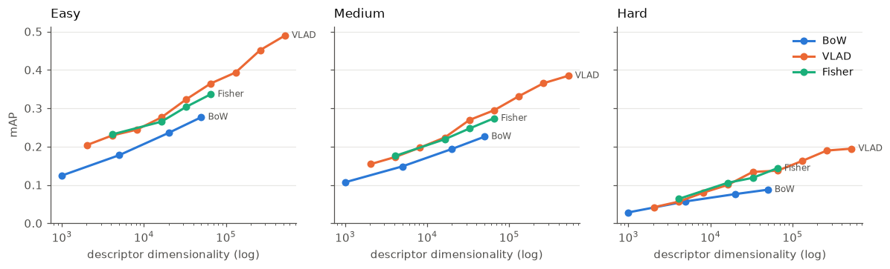
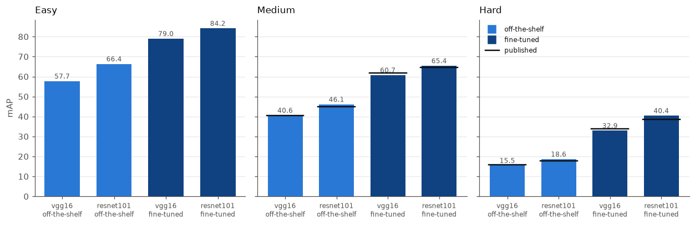
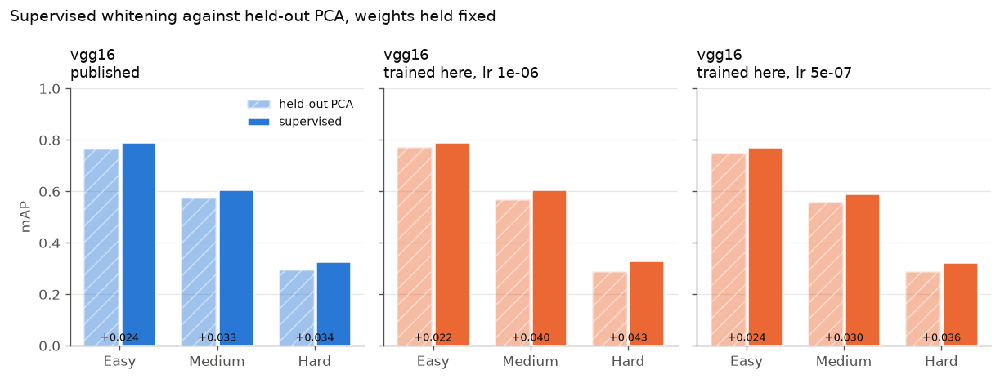

# image-retrieval
Modern image retrieval inspired by 10-year old bachelor's diploma nostalgia

## Setup

```
uv sync
```

## Downloading the benchmark data

```
uv run cbir download --datasets roxford5k rparis6k
# or: uv run cbir download --datasets all
```

Downloads the [ROxford5k and RParis6k](https://huggingface.co/datasets/galilai-group/revisitop)
image retrieval benchmarks into the default Hugging Face cache (`~/.cache/huggingface`),
shared across projects rather than duplicated locally. Each dataset is sanity-checked
against its known image/query counts before use.

Only these two configs are supported — the `revisitop1m` and `oxfordparis` configs in
the upstream loading script are broken and are rejected outright. See
[AGENTS.md](AGENTS.md) for details.

## Evaluating

```
uv run cbir evaluate --dataset roxford5k bow --k 20000
uv run cbir evaluate --dataset roxford5k vlad --k 256
uv run cbir evaluate --dataset roxford5k fisher --k 64

# a sweep is one run per k, sharing a single descriptor extraction
uv run cbir evaluate --dataset roxford5k --sweep 16 64 256 vlad --seed 0
```

### Presets

The interesting configurations carry up to ten flags, and the fine-tuned ones only work
in one combination. Every row this README quotes is available by name:

```
uv run cbir evaluate gem-ft-r101
uv run cbir evaluate gem-ft-r101 --scales 1.0   # a preset is a starting point
uv run cbir evaluate --help                     # lists techniques and presets together
```

A preset is a subcommand like any technique, not a `--preset` flag: a technique's knobs
are defined *inside* its subcommand, so a flag would have nowhere to put `--scales` and
would leave you with a configuration you cannot adjust.

They live in `configs/presets.py` as config *instances*, not YAML — so each one is
type-checked at import, validates on construction, and an override re-validates:
`--p 3.0` on a fine-tuned preset is rejected rather than quietly evaluating the network
at a pooling it was never trained for. `tests/configs/test_presets.py` holds every preset
to a row already in `results/runs.jsonl`, so a preset cannot drift from the configuration
that was actually measured.

Each run extracts RootSIFT, trains the codebook **on the other dataset**, encodes the
database and the bbx-cropped queries, searches exactly, scores all three protocols, and
appends a row to `results/runs.jsonl`. Read rows back with `cbir results`
(`--current-only` collapses re-runs). RootSIFT extraction and codebooks are cached under
`data/`, so re-running a `k` costs only the encode.

`k` means something different per technique — it is the descriptor dimensionality for
BoW, `k*128` for VLAD and `2*k*128` for Fisher — so compare on dimensionality, not `k`.

## Classic-tier results



Plotted against **descriptor dimensionality**, not `k` — the axis on which the three are
comparable, since equal `k` buys wildly unequal vectors. Regenerated by the last cell of
`notebooks/02_classic_comparison.ipynb`, so it cannot drift from the numbers below.

roxford5k, codebook held out on rparis6k, seed 0, mAP on 0–1. Medium is the headline
number in the literature; Easy is near-saturated and reported in `results/runs.jsonl`
only.

| method | k | dim | Medium | Hard |
|---|---:|---:|---:|---:|
| BoW | 1000 | 1000 | 0.107 | 0.028 |
| BoW | 5000 | 5000 | 0.148 | 0.057 |
| BoW | 20000 | 20000 | 0.194 | 0.076 |
| BoW | 50000 | 50000 | 0.226 | 0.087 |
| Fisher | 16 | 4096 | 0.176 | 0.063 |
| Fisher | 64 | 16384 | 0.219 | 0.106 |
| Fisher | 128 | 32768 | 0.247 | 0.118 |
| Fisher | 256 | 65536 | 0.274 | 0.144 |
| VLAD | 16 | 2048 | 0.154 | 0.042 |
| VLAD | 32 | 4096 | 0.173 | 0.056 |
| VLAD | 64 | 8192 | 0.197 | 0.080 |
| VLAD | 128 | 16384 | 0.224 | 0.100 |
| VLAD | 256 | 32768 | 0.269 | 0.134 |
| VLAD | 512 | 65536 | 0.295 | 0.137 |
| VLAD | 1024 | 131072 | 0.331 | 0.162 |
| VLAD | 2048 | 262144 | 0.365 | 0.190 |
| **VLAD** | **4096** | **524288** | **0.385** | **0.195** |

**Validation.** Radenović et al. report `HesAff–rSIFT–VLAD` at Medium 0.339 / Hard 0.132 on
this benchmark ([1803.11285](https://arxiv.org/abs/1803.11285), Table 5). VLAD k=1024
here reaches 0.331 / 0.162 — with OpenCV DoG SIFT rather than Hessian-Affine, no
PCA-whitening, and a vocabulary trained on rparis6k rather than a separate landmark set.
Landing on a published number is what licenses trusting the rest of the table; the larger
`k` above it then exceed that reference.

At matched dimensionality the ordering is **VLAD ≥ Fisher > BoW** at every point. Fisher
looks stronger at equal `k` only because its vector is twice as long there.

**VLAD may be levelling off near k=4096, but this is not established.** Its Medium
increments per doubling run +0.019, +0.025, +0.026, +0.046, +0.025, +0.037, +0.034,
+0.019 and Hard's run +0.014, +0.024, +0.020, +0.034, +0.003, +0.025, +0.027, +0.005. The final doubling is the smallest for
both — but Hard already dropped to +0.003 at k=512 and then resumed at +0.025 and
+0.027, so a
single small increment has misled here before. Treat k=4096 as the point where returns
stop justifying the cost (twice the storage, 5.2 → 10.5 GB for the database matrix, for
under 0.02 mAP) rather than as a demonstrated ceiling. Confirming a real plateau needs
k=8192, which this setup cannot reach.

BoW and Fisher were not pushed anywhere near their knees; both were still climbing where
they stop above, so their last rows are budget limits, not ceilings.

k=8192 is out of reach here, and RAM is not the reason: `exact_search` moves the database
matrix to the GPU, and 21 GB does not fit in 15.9 GB of VRAM. Going further needs a
chunked search, not a bigger machine.

Caveats: single seed, so small gaps are unresolved; roxford5k only, so the ranking is not
cross-checked on rparis6k; Fisher's GMM is fitted on a seeded 1M-descriptor subsample.

`notebooks/02_classic_comparison.ipynb` (classic tier) and `03_cnn_comparison.ipynb`
(CNN tiers) plot all of this from `results/runs.jsonl`; both share palettes and styling
via `notebooks/style.py`. Run it
top to bottom — it ships with outputs stripped.

For a browsable dashboard instead, install the optional extra and mirror the record:

```
uv sync --extra tracking
uv run cbir track --current-only     # replay results/runs.jsonl into trackio
trackio show --project cbir
```

trackio is entirely optional — no account, no network, one local SQLite file — and the
store is *derived* from `results/runs.jsonl`, never the reverse. Delete
`~/.cache/huggingface/trackio/cbir.db` and re-run `cbir track` to rebuild it from
scratch at any time.

### Reproducing the table

```
uv run cbir evaluate --dataset roxford5k --sweep 1000 5000 20000 50000 bow --seed 0
uv run cbir evaluate --dataset roxford5k --sweep 16 32 64 128 256 512 1024 2048 4096 vlad --seed 0
uv run cbir evaluate --dataset roxford5k --sweep 16 64 128 256 fisher --seed 0
```

Roughly 10 hours cold on 16 cores, most of it BoW's k-means at k=20000 and k=50000. VLAD
is 12–31 min per point — below k≈1024 its cost is loading descriptors rather than
clustering, so small `k` is nearly free once the sweep is running.

VLAD at k=4096 needs more than 48 GB of RAM: `encode` holds about three copies of the
10.5 GB database matrix while the ~20 GB of RootSIFT descriptors are still resident. It
was run with WSL at 64 GB. Below k=2048 the default 48 GB is fine.


## CNN-tier results

Frozen ImageNet backbones, plus the published fine-tuned checkpoints in their own
section below. Same protocol as the classic tier:
roxford5k, anything fitted is fitted on rparis6k, seed 0, mAP on 0–1, queries
bbx-cropped, multi-scale at the three published scales (1, 1/√2, 1/2). Published figures
are quoted on the same 0–1 scale; the papers themselves print them ×100.

```
uv run cbir evaluate --dataset roxford5k gem  --backbone resnet101 --p 3.0 \
    --scales 1.0 0.7071067811865476 0.5 --dim 2048 --whiten --weights caffe
uv run cbir evaluate --dataset roxford5k rmac --backbone resnet101 --levels 3 \
    --scales 1.0 0.7071067811865476 0.5 --dim 2048 --whiten --weights caffe
```

### Weight provenance is not a detail

"ImageNet-pretrained ResNet101" is not one object. `cnnimageretrieval` builds a
torchvision architecture and fills it with **Caffe-converted** ImageNet weights; we
started with torchvision's. Same architecture, same dataset, same task, different
training recipe — and the descriptors agree at cosine 0.23.

| GeM `p=3` | torchvision | caffe | Δ |
|---|---:|---:|---:|
| **ResNet101** | 0.347 | **0.461** | **+0.114** |
| ResNet50 | 0.408 | 0.425 | +0.017 |
| VGG16 | 0.420 | 0.406 | −0.014 |

It is architecture-specific, not a blanket improvement: torchvision's ResNet101 simply
transfers to retrieval far worse than its ResNet50, and on VGG16 the Caffe weights are
slightly *worse*. MAC is affected most (+0.162 on ResNet101, +0.080 on ResNet50), which
fits the measured difference in the features — Caffe's final conv map is **96% zeros at
std 0.72** against torchvision's **75% at 0.33**, a sparser, higher-contrast
representation where a max picks a real peak rather than diffuse activation.

The 53× difference in conv1 weight scale is *not* the cause: BatchNorm follows conv1 and
its `running_var` ratio (3392) matches that scale squared (2819), so it divides straight
back out. Nor is it channel order — per-filter matching is worse under BGR than RGB. The
two networks simply learned different features.

This cost six wrong hypotheses. Every one assumed the backbone was a fixed input and
looked for the bug downstream; the published table disagreeing with our measurement was
pointing at the input the whole time.

### Validation against the reference table

Radenović et al. ([1803.11285](https://arxiv.org/abs/1803.11285), Table 5), matching
their configuration — their weights, their truncation:

| method | backbone | ours | published | |
|---|---|---:|---:|---|
| GeM `p=3` | VGG16 | 0.405 / 0.155 | 0.405 / 0.157 | exact |
| GeM `p=3` | ResNet101 | 0.461 / 0.186 | 0.450 / 0.177 | above |
| MAC | ResNet101 | 0.427 / 0.172 | 0.417 / 0.180 | above |
| MAC | AlexNet | 0.276 / 0.090 | 0.283 / 0.088 | −0.7 |
| R-MAC | ResNet101 | 0.465 / 0.142 | 0.498 / 0.185 | **−3.2** |

**VGG16 reproduces exactly** once the configuration matches. Our earlier 0.420 was not a
better reproduction — it was a *different* configuration (torchvision weights, trailing
max-pool kept) that happens to score 0.015 higher than the method it was compared
against.
Both differences pushed the same way.

**R-MAC is the one row still short, with an identified cause**: the published method
PCA-whitens each *region* vector before summing them, while ours whitens the finished
descriptor. Whitening after the sum cannot undo the correlation the sum compounded.
Closing it needs a projection fitted on region vectors — permitted by the cross-dataset
rule, but deliberately not built: the cause is identified and the row is annotated, which
is worth more than a closed gap whose closing taught nothing.

### VGG's trailing max-pool

The reference builds VGG as `features[:-1]`, dropping the final max-pool; we kept it.
That is 4× the positions on the conv map — 64×64 against 32×32 at `max_side=1024`.

| vgg16 GeM `p=3` | pool kept | pool dropped |
|---|---:|---:|
| torchvision weights | 0.420 / 0.156 | 0.416 / **0.167** |
| caffe weights | 0.406 / 0.154 | 0.405 / 0.155 |

Small on Medium, but dropping it is worth **+0.011 Hard** on torchvision weights — more
positions to pool over helps most where the object is small or partly occluded.

### The full grid

All backbones on **torchvision** weights, whitened at native width, so the columns are
comparable to each other. The two ResNet rows that Caffe weights change materially are
noted underneath.

| backbone | dim | SPoC | MAC | GeM `p=3` | R-MAC |
|---|---:|---|---|---|---|
| AlexNet¹ | 256 | 0.210 / 0.025 | 0.276 / 0.090 | 0.279 / 0.072 | 0.244 / 0.041 |
| VGG16 | 512 | 0.372 / 0.109 | 0.349 / 0.137 | **0.420** / 0.156 | 0.344 / 0.073 |
| VGG19 | 512 | 0.347 / 0.100 | 0.346 / 0.151 | 0.400 / **0.184** | 0.336 / 0.065 |
| ResNet18 | 512 | 0.323 / 0.063 | 0.226 / 0.070 | 0.282 / 0.081 | 0.313 / 0.051 |
| ResNet34 | 512 | 0.324 / 0.059 | 0.243 / 0.065 | 0.298 / 0.068 | 0.336 / 0.067 |
| ResNet50 | 2048 | 0.429 / 0.142 | 0.322 / 0.111 | 0.408 / 0.140 | 0.451 / 0.127 |
| ResNet101 | 2048 | 0.381 / 0.102 | 0.265 / 0.067 | 0.347 / 0.108 | 0.428 / 0.111 |
| **ResNet101 (caffe)** | 2048 | 0.419 / 0.136 | 0.427 / 0.172 | 0.461 / **0.186** | **0.465** / 0.142 |
| *(VLAD k=4096, classic)* | *524288* | | | *0.385 / 0.195* | |

¹ AlexNet unwhitened — whitening costs mAP at 256-D.

**Best: ResNet101 R-MAC 0.465 Medium** from 2048 dimensions, against the classic tier's
best of VLAD k=4096 at 0.385 from **524288**. Hard is now close too — 0.186 against
VLAD's 0.195, where it used to be a rout.

**Which pooling wins is backbone-dependent.** GeM leads on VGG; the sum-like poolings
lead on the torchvision ResNets. Note the earlier claim that "MAC is worst on every
ResNet" was an artifact of the wrong weights: on Caffe ResNet101 it is second-best and
has the tier's second-best Hard.

**Depth buys little at fixed width.** ResNet18 → ResNet34 gains ~0.017 averaged over
methods; VGG16 → VGG19 loses Medium and gains Hard. The 512 → 2048 width jump is worth
far more, and weight provenance more than either.

### Whitening

Fitted on the held-out benchmark unless a row says otherwise. Gains sort by how much a
method **sums** rather than **maxes** — summing piles up shared components and whitening
decorrelates them, while a max creates no such correlation.

| VGG16, multi-scale | plain | + whitening | gain |
|---|---:|---:|---:|
| SPoC | 0.271 | 0.372 | **+0.102** |
| R-MAC | 0.282 | 0.344 | +0.062 |
| GeM `p=3` | 0.364 | 0.420 | +0.056 |
| MAC | 0.320 | 0.349 | +0.029 |

It reverses on AlexNet, where whitening costs MAC 0.033 mAP (0.229 → 0.196 single-scale) —
at 256-D there is little redundancy to remove and a proportionally noisier tail. Worth
measuring per backbone rather than assuming.

**`--shrinkage ε`** floors whitening's divisor at `sqrt(λ + ε·mean(λ))`. Whitening
divides by `sqrt(λ)`, and when the fitting set is not much larger than the descriptor the
smallest eigenvalues are noise. At 2048 components fitted on 2100 images the pipeline
scores **0.067** unshrunk and **0.393** at ε=0.1. In the regime we actually run (6322
images) it is worth +0.004 to +0.010 on the 2048-D backbones and +0.001 on VGG16 at
512-D.

**`--whiten-source sfm30k|sfm120k`** fits whitening on the retrieval-SfM landmark corpus
the reference uses (a 37.7 GB manual download; see `descriptors/cnn/sfm.py`). Worth +0.023
Medium on *torchvision* ResNet101 — but once the weights are right it stops helping
(0.461 → 0.453), so that gain was whitening compensating for weak features. It saturates
by ~30k images: 30k and 120k differ by 0.002.

### Fine-tuned checkpoints

Everything above is a frozen ImageNet classifier: optimized to tell a golden retriever
from a poodle, and useful for retrieval only because the features happen to transfer.
Radenović et al. also publish the same architectures **fine-tuned for retrieval itself**,
on retrieval-SfM-120k with a contrastive loss over landmark pairs mined by
structure-from-motion. Oxford/Paris overlaps were removed from that corpus, so the
cross-dataset rule holds: nothing was fitted on what it searches.

| backbone | scales | Medium mAP | mP@10 | Hard mAP | mP@10 |
|---|---|---:|---:|---:|---:|
| VGG16 | single | 0.593 | 0.810 | 0.323 | 0.499 |
| VGG16 | multi | 0.607 | 0.823 | 0.329 | 0.510 |
| ResNet101 | single | 0.630 | 0.833 | 0.383 | 0.541 |
| **ResNet101** | **multi** | **0.654** | **0.860** | **0.404** | **0.564** |

Against Table 5, which reports both metrics on both protocols — eight comparisons, not
two, and the paper does not evaluate Easy at all:

| multi-scale | Medium mAP | mP@10 | Hard mAP | mP@10 |
|---|---:|---:|---:|---:|
| VGG16 ours | 0.607 | 0.823 | 0.329 | 0.510 |
| V–[37]–GeM published | 0.619 | 0.827 | 0.337 | 0.510 |
| | −0.012 | −0.004 | −0.008 | **0.000** |
| ResNet101 ours | 0.654 | 0.860 | 0.404 | 0.564 |
| R–[37]–GeM published | 0.647 | 0.847 | 0.385 | 0.530 |
| | **+0.007** | **+0.013** | **+0.019** | **+0.034** |



**This is what the exercise was for.** Every earlier validation point sat at the bottom
of the published range, 0.40–0.46, where a 0.02 discrepancy is hard to read. Reproducing
0.647 confirms the evaluation path at the top of the range as well, so the gaps in the
off-the-shelf grid above are descriptor gaps and not harness gaps.

ResNet101 lands above its published row and VGG16 below its own — opposite directions,
which is not the shape a pipeline error takes. VGG16's Hard mP@10 is exact and its
Medium mP@10 is −0.004, so the top of its ranking matches and the ~0.01 mAP shortfall is in
the tail. One candidate was tested and rejected: matching the reference's resize order
(normalize first, then bilinearly interpolate the tensor, rather than our single bicubic
PIL resize from the original) moved Medium +0.002 and Hard −0.002. The residual is left
unexplained rather than tuned away.

**The pooling was never the problem.** `p` is differentiable and was therefore trained,
not chosen — and it came out at **2.9208** (VGG16) and **2.9033** (ResNet101) against the
hand-picked 3.0 used everywhere above. Training moved it by 3%. The entire ~0.19 mAP gap
between the off-the-shelf and fine-tuned rows is in the conv weights.

A checkpoint carries three things, and loading only the first would silently produce a
plausible wrong number: the conv stack, the trained `p`, and a supervised whitening
fitted on matching pairs after training (`meta['Lw']`, in `ss` and `ms` variants for
single- and multi-scale runs). The last of these means these runs fit **nothing** at
extraction time — there is no held-out pass at all, which is why they are also the
fastest rows in the tier.

```
uv run cbir evaluate --dataset roxford5k gem --backbone resnet101 --weights sfm120k \
    --p learned --scales 1.0 0.7071067811865476 0.5 --whiten --whiten-source learned
```

Checkpoints are a manual download (`retrievalSfM120k-vgg16-gem-b4dcdc6.pth`,
`retrievalSfM120k-resnet101-gem-b80fb85.pth`) into `CBIR_WEIGHTS_ROOT`; see
`descriptors/cnn/finetuned.py`. Only GeM was published — there is no fine-tuned R-MAC
checkpoint, and asking for one is refused rather than silently downgraded.

### Where the tiers stand


Same benchmark, same protocol, best row from each:

| tier | descriptor | dim | Medium | Hard |
|---|---|---:|---:|---:|
| classic | VLAD k=4096 | 524288 | 0.385 | 0.195 |
| off-the-shelf CNN | ResNet101 R-MAC, caffe | 2048 | 0.465 | 0.142 |
| off-the-shelf CNN | ResNet101 GeM `p=3`, caffe | 2048 | 0.461 | 0.186 |
| fine-tuned CNN | ResNet101 GeM, multi-scale | 2048 | **0.654** | **0.404** |

The off-the-shelf tier needs two rows because no single one wins both protocols: R-MAC
takes Medium and GeM takes Hard, and R-MAC's Hard is its weakest result — the
per-region-whitening gap documented above. Either way that tier beats the classic one on
Medium from a vector 256× shorter, while **losing** to it on Hard (0.195 against 0.186).

The fine-tuned row wins both outright: +0.270 Medium and +0.210 Hard over VLAD, at 1/256
the width — because the network was trained for the question being asked instead of
borrowed from a classifier.

That stays true only within the CNN era: a frozen DINOv3 beats this row on both protocols
without any retrieval training — see [Transformer-tier results](#transformer-tier-results).

### Neural Codes

| backbone | dim | Medium | Hard |
|---|---:|---:|---:|
| AlexNet fc6 | 4096 | 0.122 | 0.028 |
| AlexNet fc6 + PCA | 256 | 0.117 | 0.025 |
| VGG16 fc6 | 4096 | 0.163 | 0.051 |
| VGG16 fc6 + PCA | 512 | 0.154 | 0.050 |

Losing to everything else is expected. Babenko et al.
([1404.1777](https://arxiv.org/abs/1404.1777)) report the same ordering for codes off an
ILSVRC-trained network — their contribution is that *retraining* on a landmark set fixes
it, and this harness runs frozen networks only. There is no ROxford reference for the
method, so these rows compare only against our own.

### Other findings

**Multi-scale** is worth +0.047 Medium on AlexNet MAC (0.229 → 0.276). Per-scale descriptors
are L2-normalized before combining, then combined by averaging for every method except
GeM, which reuses its own generalized mean (Radenović et al., §Multi-scale) — worth
~0.002 mAP.

**The `p` curve is flat at its top.** On AlexNet, Medium runs 0.210, 0.258, 0.279,
0.287, 0.285, 0.262 for `p` = 1, 2, 3, 4, 5, 10 — the 3–5 span sits inside 0.008,
unresolvable at one seed. Hard rises monotonically with `p` to true max.

**A note on the last digit.** Two runs of one configuration, identical params and an
identical code path, recorded 0.4200 and 0.4211 (VGG16 GeM `p=3`, torchvision). Nothing in
`params` differed and the intervening change was provably a no-op at `shrinkage=0`, so
that 0.0011 is run-to-run nondeterminism in the pipeline itself. **Treat differences
below roughly 0.002 mAP as noise** — which is the empirical version of the caution the `p` sweep
already states. It also means a figure may disagree with a table in its last digit: the
notebooks plot the *most recent* measurement of each configuration, the tables quote the
run they were written against.

Caveats: single seed throughout, and **roxford5k only** — every number here evaluates on
roxford5k with rparis6k as the held-out set, and the reverse direction was deliberately
not run. Nothing here is evidence that a conclusion generalizes to the second benchmark,
and the published tables score rparis6k considerably higher (R–[37]–GeM: 0.647 ROxf
against 0.772 RPar), so these numbers are the harder half of the usual pair rather than a
representative sample of it. Input is capped at `max_side=1024` and never enlarged, except that
scaled inputs are floored at each backbone's conv-stack minimum (63 px AlexNet, 32 px
elsewhere), which can only trigger below full scale.

## Training a network here

Everything above evaluates weights someone else produced. `cbir train` fine-tunes a
backbone on retrieval-SfM-120k with the reference's recipe, and `cbir whiten` fits the
supervised projection that finishes it — so the question stops being "can we score their
checkpoint" and becomes **"can we produce one"**.

```
uv run cbir train --backbone vgg16 --weights caffe --epochs 100 --lr 1e-6
uv run cbir evaluate gem --backbone vgg16 --weights sfm120k --p learned --no-last-pool \
    --scales 1.0 0.7071067811865476 0.5 --whiten --whiten-source learned \
    --checkpoint data/runs/vgg16-gem-margin0.7-lr1e-06-seed0/best.pth
```

Whitening is fitted automatically as the last step of training, so the checkpoint the
command leaves behind is already complete; `cbir whiten` exists to refit one separately.


| multi-scale, supervised whitening | Easy | Medium | Hard |
|---|---:|---:|---:|
| VGG16 published | 0.790 | 0.607 | 0.329 |
| **VGG16 trained here** (45 epochs) | **0.793** | **0.609** | **0.332** |
| | +0.003 | +0.002 | +0.003 |
| ResNet101 published | 0.842 | 0.654 | 0.404 |
| ResNet101 trained here (19 epochs) | 0.835 | 0.636 | 0.372 |
| | −0.006 | **−0.018** | **−0.033** |

**VGG16 reproduces.** All three gaps sit at or inside the 0.002 noise floor documented
below, so the defensible claim is that the two checkpoints are indistinguishable — not
that ours is better.

**ResNet101 does not, and the shortfall is concentrated on Hard.** Two hypotheses, not
yet separated:

* **Undertrained.** Early stopping ended it at epoch 19 against VGG16's 45. The VGG16 run
  is direct evidence this rule stops too early: its epochs 31–45 gained only +0.006
  validation mAP — under the 0.001-per-epoch threshold that ends a run — while gaining
  **+0.007 Medium** on the benchmark. Validation plateaus before the benchmark does.
* **Whitening under-fitted.** The projection is a `D x D` covariance, and ResNet101's
  D is 2048 against VGG16's 512. At 30000 pairs that is 14.6x the width where VGG16 got
  39x. Whitening's largest effect on VGG16 was on Hard (+0.040), which is exactly where
  ResNet101 loses most.

**The second was tested and is real but small.** Refitting on all 180000 available pairs
— 88x the width, matching what the reference has to work with — touches the projection
and leaves the weights alone:

| ResNet101 whitening pairs | Easy | Medium | Hard |
|---|---:|---:|---:|
| 30000 | 0.836 | 0.632 | 0.367 |
| 180000 | 0.835 | **0.636** | **0.372** |
| | −0.001 | +0.004 | +0.004 |

Both gains clear the noise floor, and both are about a fifth of the deficit. **So
undertraining carries the rest.** Early stopping ended ResNet101 at 19 epochs against
VGG16's 45, and the rule that ended it is the one VGG16 showed to be too eager. The
table above already reflects the refit; the retrain is outstanding.

### What each step is worth



Read through held-out PCA instead of its own projection, the *same* trained VGG16 scores
0.569 Medium against 0.609. The supervised projection is worth **+0.033 Medium and
+0.040 Hard** — roughly four times what doubling the learning rate bought — from a
closed-form solve rather than hours of GPU. This is why a checkpoint without one is
treated as half-finished.

Learning rate mattered less, and only because it was wrong to begin with: no VGG16
command was ever published, so 5e-7 had been borrowed from the ResNet101 one. The
reference's own VGG16 default is 1e-6, and correcting it was worth +0.011 Medium.
ResNet101 keeps 5e-7, which *is* published for that backbone.


Validation mAP per epoch for the three runs, from the trackio store the loop writes.
Measured on the held-out SfM landmark split, **not** roxford5k — a different corpus and a
different label definition, so it ranks checkpoints during a run and nothing more. Its
saturation is exactly why it stops runs too early:


### Two bugs this exercise found

**BatchNorm was training on a batch of one.** Images keep their aspect ratios and so
cannot be stacked, meaning each goes through its own forward pass — and `model.train()`
left ResNet101's 104 BatchNorm layers estimating statistics from a single image. Training
and evaluation therefore computed different functions: one image's descriptor had cosine
similarity **0.58** between the two modes. Validation mAP fell from 0.6465 untrained to
0.1545 by the fourth epoch *while the training loss kept falling*. VGG16 has no BatchNorm
and reproduced the published number with this bug present, which is why it survived.
Freezing the statistics restores the equivalence exactly (cosine 1.000000), as the
reference does; the affine parameters stay trainable.

**Early stopping paid for itself immediately.** It caught that divergence at epoch 5
unprompted — a failure mode it was not written for — and saved ~19 hours. On the healthy
runs it ended VGG16 at 46 of 100 and ResNet101 at 19, keeping the best checkpoint in both
cases: the patience counter ignores gains under `min_delta`, but `best.pth` still tracks
every improvement, so stopping early never discards a better model.

## Transformer-tier results

Frozen vision transformers, each read out by its own image embedding: the CLS token after
the final LayerNorm for DINOv2, DINOv3 and DeiT, the attention-pooling head for SigLIP 2
(which has no CLS token). Compared by cosine. Unless a row says otherwise nothing is
fitted — no PCA, no whitening — so nothing touches the held-out set; the Whitening section
below is the exception. The preprocessing is the one protocol the DINOv3 paper
documents (App. D.8): the longer side resized to 224, the image centred on a black square,
each family normalized as it was trained. Queries are bbx-cropped, as for every other
tier.

```
uv run cbir evaluate --dataset roxford5k vit --model dinov3-vitl16
uv run cbir evaluate --dataset roxford5k vit --model dinov2-vitl14 --image-size 448
uv run cbir evaluate --dataset rparis6k vit --model siglip2-vitl16-384 --image-size 384
uv run cbir evaluate --dataset roxford5k vit --model siglip2-vitl16-512 --image-size 512 --whiten
uv run cbir evaluate --dataset roxford5k vit --model dinov3-vitl16 --resize aspect --readout gem --p 3.0
```

DINOv3's weights are gated on Hugging Face: accept the license on the
[model page](https://huggingface.co/facebook/dinov3-vitl16-pretrain-lvd1689m) first, or
the download fails with a 403.

| model | dim | roxford5k Medium | roxford5k Hard | rparis6k Medium | rparis6k Hard |
|---|---:|---:|---:|---:|---:|
| DINOv2 ViT-S/14 | 384 | 0.577 | 0.354 | 0.816 | 0.648 |
| DINOv2 ViT-B/14 | 768 | 0.641 | 0.417 | 0.884 | 0.751 |
| DINOv2 ViT-L/14 | 1024 | 0.729 | 0.528 | **0.918** | 0.818 |
| DINOv2 ViT-g/14 | 1536 | 0.697 | 0.494 | **0.918** | **0.824** |
| DINOv3 ViT-S/16 | 384 | 0.635 | 0.418 | 0.816 | 0.651 |
| DINOv3 ViT-B/16 | 768 | 0.741 | 0.552 | 0.889 | 0.762 |
| DINOv3 ViT-L/16 | 1024 | **0.810** | **0.637** | 0.910 | 0.811 |
| SigLIP 2 ViT-L/16, 256 px | 1024 | 0.373 | 0.106 | 0.734 | 0.521 |
| DeiT-S/16†, 224 px | 384 | 0.216 | 0.066 | 0.588 | 0.327 |
| DeiT-B/16†, 224 px | 768 | 0.252 | 0.069 | 0.640 | 0.382 |
| DeiT-B/16†, 384 px | 768 | 0.301 | 0.085 | 0.656 | 0.417 |

DINOv3 ViT-L is the tier's best on roxford5k, 0.081 Medium and 0.109 Hard above DINOv2
ViT-L — and even DINOv3 ViT-B beats DINOv2 ViT-L there. On rparis6k the two generations
are level, DINOv2 slightly ahead.

It is also the first transformer row that reproduces a published number under this
benchmark's protocol: the DINOv3 paper reports 63.1 roxford5k Hard for ViT-L/16, against
0.637 here. That paper says it follows Radenović et al.'s protocol, and the match suggests
it cropped its queries — unlike the DINOv2 paper (below).

Against the other tiers, on roxford5k Medium / Hard:

| tier | best row | Medium | Hard |
|---|---|---:|---:|
| classic | VLAD k=4096 | 0.385 | 0.195 |
| off-the-shelf CNN | ResNet101 R-MAC, caffe, whitened | 0.465 | 0.142 |
| off-the-shelf CNN | ResNet101 GeM `p=3`, caffe, whitened | 0.461 | 0.186 |
| fine-tuned CNN | ResNet101 GeM, Radenović et al.'s published checkpoint | 0.654 | 0.404 |
| fine-tuned CNN | ResNet101 GeM, trained here (19 epochs) | 0.636 | 0.372 |
| frozen supervised ViT | DeiT-B/16†, 384 px | 0.301 | 0.085 |
| fine-tuned ViT | DeiT-B/16†, 224 px, IRT recipe, trained here (stretch) | 0.422 | 0.207 |
| frozen vision-language | SigLIP 2 ViT-L/16, 512 px, whitened | 0.432 | 0.189 |
| frozen self-supervised | DINOv3 ViT-L/16, 224 px | **0.810** | **0.637** |

Each row is that tier's best post-processing: the off-the-shelf CNN and SigLIP 2 rows are
PCA-whitened, the fine-tuned CNN rows use their supervised projection, and the DINO row is
not whitened, because whitening costs DINO points (see below).

A frozen self-supervised network beats the CNN fine-tuned for this very task — the
published checkpoint — by 0.156 Medium and 0.233 Hard, and the one trained here by 0.174
and 0.265. A frozen image-text network of the same size, whitened, only draws
level with the off-the-shelf CNN and with VLAD: SigLIP 2 is trained to say *what* a
picture shows, and this benchmark asks *which* building it is. Unwhitened it sits about 7
points below the DINOv3 paper's SigLIP 2 ViT-L (21.4 Hard), whitened about 2.5; that
paper does not say how it fed SigLIP, so the gap is unexplained rather than attributed.

DeiT is the same ViT architecture trained as a supervised ImageNet classifier (distilled
from a CNN teacher, hence †) — the transformer counterpart of the CNN tier's ImageNet
ResNets, and the checkpoints the IRT recipe fine-tunes. Frozen, it is the weakest row in
the project, below VLAD: a classifier's CLS token describes the *class*, and every image
here is a building. It is the "before" row for retrieval fine-tuning, not a contender.
Low enough to look like a bug, so it was checked against the DINO paper's supervised
ViT-S/16 (33.5 / 8.9 roxford5k, 63.0 / 37.2 rparis6k, measured with uncropped queries):
run the same way through `scripts/dinov2_uncropped_queries.py`, DeiT-S† gives 31.8 / 13.3
and 60.8 / 34.1 — within a few points despite being the distilled checkpoint rather than
theirs. Between that protocol and this one it moves 0.102 roxford5k Medium, against
0.110 for DINOv2-S under the same comparison — the crop's toll on a small model again.

### Resolution

224 px is low for a landmark that fills part of a 1024-px photograph, so the DINO and
SigLIP 2 models were also run larger (DeiT's two sizes are in the table above). SigLIP 2 ships one checkpoint per resolution, so its rows are three
networks; the DINO rows are one network fed differently.

| model | size | roxford5k M / H | rparis6k M / H |
|---|---:|---|---|
| DINOv2 ViT-S/14 | 224 / 448 / 518 | 0.577 / 0.354 · 0.601 / 0.380 · 0.601 / 0.383 | 0.816 / 0.648 · 0.831 / 0.663 · 0.828 / 0.658 |
| DINOv2 ViT-B/14 | 224 / 448 / 518 | 0.641 / 0.417 · 0.683 / 0.490 · 0.667 / 0.450 | 0.884 / 0.751 · 0.889 / 0.759 · 0.887 / 0.757 |
| DINOv2 ViT-L/14 | 224 / 448 / 518 | 0.729 / 0.528 · 0.715 / 0.482 · 0.714 / 0.479 | 0.918 / 0.818 · 0.919 / 0.825 · 0.919 / 0.825 |
| DINOv2 ViT-g/14 | 224 / 448 / 518 | 0.697 / 0.494 · 0.713 / 0.532 · 0.714 / 0.536 | 0.918 / 0.824 · 0.924 / 0.838 · 0.923 / 0.836 |
| DINOv3 ViT-L/16 | 224 / 448 / 512 | 0.810 / 0.637 · 0.798 / 0.632 · 0.803 / 0.642 | 0.910 / 0.811 · 0.911 / 0.813 · 0.913 / 0.816 |
| SigLIP 2 ViT-L/16 | 256 / 384 / 512 | 0.373 / 0.106 · 0.402 / 0.131 · 0.396 / 0.146 | 0.734 / 0.521 · 0.746 / 0.540 · 0.751 / 0.546 |

There is no single direction. Resolution helps DINOv2 ViT-S, B and g on roxford5k (B by
0.073 Hard), *hurts* DINOv2 ViT-L (0.528 → 0.482 Hard), and leaves DINOv3 ViT-L flat
within a point. rparis6k barely moves for anyone. 448 and 518 differ by at most 0.04, and
518 is never clearly better. The protocol's 224 costs neither ViT-L anything — and with 70
queries per dataset, differences of one or two points are near what this benchmark can
resolve.

### Whitening

The off-the-shelf CNN rows are all PCA-whitened, so the same fit was tried on the
transformers: on the held-out benchmark at full width, as those rows are, and on sfm30k
for DINOv3.

| model | whitened on | roxford5k M / H | gain | rparis6k M / H | gain |
|---|---|---|---|---|---|
| DINOv3 ViT-L/16 | held-out | 0.791 / 0.611 | −0.020 / −0.026 | 0.904 / 0.803 | −0.007 / −0.008 |
| DINOv3 ViT-L/16 | sfm30k | 0.778 / 0.593 | −0.032 / −0.044 | 0.907 / 0.804 | −0.004 / −0.007 |
| DINOv2 ViT-L/14 | held-out | 0.708 / 0.499 | −0.021 / −0.029 | 0.911 / 0.802 | −0.007 / −0.016 |
| DeiT-B/16†, 384 px | held-out | 0.299 / 0.081 | −0.002 / −0.005 | 0.661 / 0.427 | +0.004 / +0.010 |
| SigLIP 2 ViT-L/16, 512 px | held-out | 0.432 / 0.189 | +0.036 / +0.042 | 0.821 / 0.652 | +0.069 / +0.107 |

Whitening **hurts** both DINO generations, and it is not a noisy covariance: fitted on
sfm30k, five times more images, DINOv3 loses more, not less. Self-distillation already
spreads its features; whitening then inflates directions that are weak for a reason.
SigLIP 2 gains up to 0.107 — the CNN tier's pattern again, where whitening pays most for
descriptors whose dimensions share structure, and an image-text embedding is dominated by
broad semantic directions. DeiT does not move.

### CLS against pooled patch tokens

The patch grid is a transformer's counterpart of a conv map, so the CNN tier's pooling
applies to it directly: `--readout mean` averages the patch tokens (SPoC over tokens),
`--readout gem --p 3.0` takes their generalized mean. The prefix tokens — CLS, DINOv3's
four registers, DeiT's distillation token — are excluded, and every batch checks that
what is left is exactly the patch grid.

| model | readout | `pad` roxford5k M / H | `aspect` roxford5k M / H | `aspect` rparis6k M / H |
|---|---|---|---|---|
| DINOv3 ViT-L/16 | CLS | **0.810 / 0.637** | 0.800 / 0.614 | 0.907 / 0.806 |
| DINOv3 ViT-L/16 | mean | 0.345 / 0.190 | 0.443 / 0.224 | 0.797 / 0.640 |
| DINOv3 ViT-L/16 | GeM `p=3` | 0.361 / 0.202 | 0.468 / 0.250 | 0.811 / 0.652 |
| DINOv2 ViT-L/14 | CLS | 0.729 / 0.528 | 0.716 / 0.520 | 0.918 / 0.816 |
| DINOv2 ViT-L/14 | mean | 0.320 / 0.150 | 0.451 / 0.205 | 0.800 / 0.641 |
| DINOv2 ViT-L/14 | GeM `p=3` | 0.326 / 0.140 | 0.473 / 0.197 | 0.796 / 0.624 |

**The padding is a trap for pooled readouts.** Under `pad`, the black bars are patches,
and a mean averages them in: a quarter of a 4:3 photo, more than half of a narrow query
crop. Removing them (`aspect`) is worth 0.10–0.15 roxford5k Medium to the pooled
readouts and nothing to CLS, which attends past them. So pooled rows must be measured
under `aspect`; the `pad` ones are recorded but understate pooling.

Even so, **CLS wins by a wide margin**: 0.800 against 0.468 for DINOv3 without padding.
DINO's patch tokens are trained for dense tasks; the image-level summary is what CLS
learns. GeM edges out the mean despite its clamp discarding the tokens' negative half.

DeiT and SigLIP 2 cannot run unpadded — their position embeddings fix a square input — so
their pooled rows are confounded by the bars and no conclusion is drawn from them (both
are lower than their native readouts: DeiT 0.178 mean and 0.225 GeM against 0.301 CLS,
SigLIP 2 0.351 and 0.347 against 0.396 on roxford5k Medium).

### The DINOv2 paper uses a different protocol

These rows sit below the DINOv2 paper's Table 9 — far below for the small models on
roxford5k (ViT-S 0.577 / 0.354 against a published 0.688 / 0.432) — because the paper
evaluates differently. It does not state its protocol, but its numbers match the DINO
group's public [`eval_image_retrieval.py`](https://github.com/facebookresearch/dino),
which loads each query image whole and never applies its `bbx`. The benchmark's labels
describe the crop, so this project keeps cropping, and Table 9 is not directly comparable
to anything here.

`scripts/dinov2_uncropped_queries.py` replicates that script outside the harness — it
writes nothing to `results/` — and lands within 0.1–1.6 mAP of Table 9 for ViT-S, B and L
on both datasets, which is what pins the difference on the protocol rather than on this
implementation. Changing padding, interpolation or the centre-crop transform did not
close the gap (those runs are recorded, `--resize aspect|crop`, `--interpolation`).

### Training a transformer here (IRT)

The trainable half starts with IRT (El-Nouby et al. 2021,
[2102.05644](https://arxiv.org/abs/2102.05644)): the GeM recipe above with the backbone
swapped — DeiT for ResNet, CLS for GeM, the same SfM-120k tuples, contrastive loss and
optimizer, margin 0.85, 100 epochs. `cbir train` runs it for any CLS model:

```
uv run cbir train --backbone deit-vits16-dist-224 --epochs 100 --patience None
uv run cbir evaluate --dataset roxford5k vit --model deit-vits16-dist-224 --resize stretch \
    --checkpoint data/runs/deit-vits16-dist-224-cls-margin0.85-lr5e-07-seed0/best.pth
```

IRT squashes every image, training and evaluation alike, "into a square image" — aspect
ratio discarded, no bars. That is `--resize stretch`, a different geometry from the
padded protocol above, so the "before" rows are re-measured under it: frozen DeiT-B† 384
scores 0.349 Medium here against 0.301 padded. Comparing a trained row to the padded one
would credit training with five points the geometry earned.

| DeiT†, CLS, `stretch` | ROxf M | ROxf H | RPar M | RPar H |
|---|---:|---:|---:|---:|
| S† 224, frozen | 0.243 | 0.090 | 0.598 | 0.333 |
| **S† 224, trained here** | **0.352** | **0.166** | **0.666** | **0.424** |
| S† 224, IRT Table 7 | 34.5 | 15.8 | 65.8 | 42.0 |
| B† 224, frozen | 0.291 | 0.091 | 0.647 | 0.386 |
| **B† 224, trained here** | **0.422** | **0.207** | **0.674** | **0.430** |
| B† 224, IRT Table 7 | 39.5 | 17.4 | 67.5 | 43.6 |

**IRT reproduces.** S† lands within 0.8 of the paper on all four numbers, and B† within
0.6 on rparis6k. B† is 2.7 / 3.3 *above* the paper on roxford5k: larger than S†'s gaps,
but in the direction a harness bug rarely produces, from the same code that matched
everywhere else, on a 70-query benchmark from one seed each side. Recorded as a gap, not
attributed; a second seed would say whether it is noise.

Training lifts roxford5k by 11–13 Medium and rparis6k by 3–7, and neither run had
finished improving: validation mAP on SfM rose for all 100 epochs (S† 0.643 → 0.802, B†
0.702 → 0.824), flattening only at the end. Early stopping is off for these runs, which
is what the ResNet101 run above argues for.

PCA-whitening fitted on SfM-120k *lowers* the trained S† (roxford5k 0.338 / 0.134,
rparis6k 0.643 / 0.402), so the rows are raw CLS. The paper uses PCA only to reduce to
128 dimensions.

Not run: B† 384 (IRT's headline row, 50.5 / 22.7) and IRT_R's entropy regularizer. Both
are DeiT, and the best IRT row still sits ~25 Medium below frozen DINOv3-L — the
reproduction is settled by the two rows above, and the open question is DINO's.

**Next: the same recipe on DINOv2.** Two measurements set it up. First, the "before"
rows under `stretch` — which, as for DeiT, scores slightly above the padded protocol:

| frozen, CLS, 224 | ROxf M | ROxf H | RPar M | RPar H |
|---|---:|---:|---:|---:|
| DINOv2-S/14, `stretch` | 0.596 | 0.387 | 0.827 | 0.662 |
| DINOv2-S/14, `pad` | 0.577 | 0.354 | 0.816 | 0.648 |
| DINOv2-B/14, `stretch` | 0.648 | 0.424 | 0.888 | 0.759 |
| DINOv2-B/14, `pad` | 0.641 | 0.417 | 0.884 | 0.751 |

Second, how much of the training objective each frozen model already solves — mAP on the
SfM validation split, the number every training run logs as epoch 0
(`scripts/sfm_validation.py`):

| model | SfM val mAP |
|---|---:|
| DeiT-S† 224, frozen → trained here | 0.643 → 0.802 |
| DeiT-B† 224, frozen → trained here | 0.702 → 0.824 |
| DINOv2-S/14, frozen | 0.858 |
| DINOv2-B/14, frozen | 0.887 |
| DINOv2-L/14, frozen | 0.905 |
| DINOv3-L/16, frozen | 0.928 |

Frozen DINOv2-S already starts above where 100 epochs of IRT leave DeiT-B†. The recipe has
far less room on DINO than it had on DeiT — and what room there is does not reach the
benchmark. **Full fine-tuning makes DINOv2 worse:**

| DINOv2, CLS, 224, `stretch` | ROxf M | ROxf H | RPar M | RPar H |
|---|---:|---:|---:|---:|
| S/14 frozen | 0.596 | 0.387 | 0.827 | 0.662 |
| S/14 IRT recipe, trained here (best epoch 38) | 0.575 | 0.375 | 0.793 | 0.599 |
| | −0.021 | −0.012 | −0.034 | −0.064 |
| B/14 frozen | 0.648 | 0.424 | 0.888 | 0.759 |
| B/14 IRT recipe, trained here (best epoch 48) | 0.640 | 0.405 | 0.874 | 0.742 |
| | −0.008 | −0.019 | −0.015 | −0.017 |

SfM validation peaked early (S 0.857 → 0.888 at epoch 38, B 0.887 → 0.909 at epoch 48) and
then slid while the training loss kept falling — the network fitting SfM's tuples — and
`best.pth` is the validation peak, so these rows are the recipe at its best. Even so, the
SfM gain does not transfer to Oxford and Paris. The bigger model loses less. Retrieval
training that rewrites every weight overwrites more of what 142M-image pretraining learned
than SfM-120k can teach back — which is the case for LoRA, next.

Batching is what makes 100 epochs affordable: square inputs stack, so mining and
validation run 64 images per forward and a tuple goes through as one, with JPEG decoding
in DataLoader workers. An S† epoch takes ~125 s (B† ~175 s) instead of ~11 minutes, and
tests pin that the descriptors and the loss are the ones one-image-per-forward gives.
