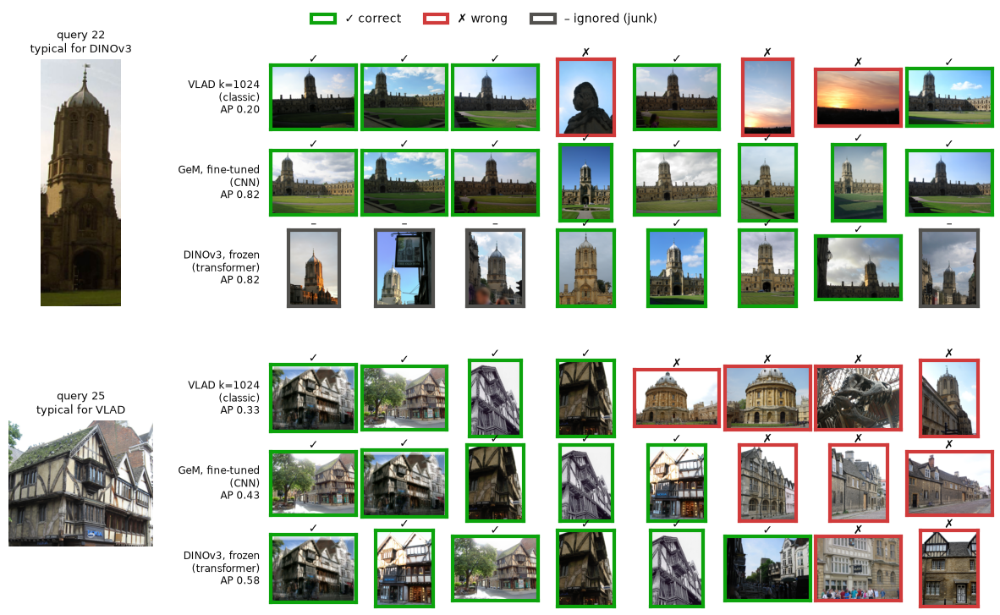

# image-retrieval

Give it a photo of a building; it finds the other photos of that building in a collection
of thousands — from other angles, at night, half hidden behind scaffolding. That is
**content-based image retrieval**, and it was the topic of my bachelor's diploma ten years
ago.

This project rebuilds that diploma with today's tools and asks a simple question: **how
much better have we actually got?** Three generations of methods are measured on the same
benchmark, under the same rules, in one harness:

- **classic** (the diploma's era): hand-crafted SIFT features and a visual vocabulary;
- **CNN**: features of image-classification networks, then networks trained for retrieval;
- **ViT** (vision transformer): today's foundation models (DINOv2, DINOv3, SigLIP 2), frozen and
  fine-tuned.



The top eight results for two queries from revisited Oxford, picked by a fixed rule rather
than for looks: in the first, DINOv3 scores what it scores on average; in the second, VLAD
does. Green is a photo of the same building, red a wrong one, grey a photo the benchmark's
annotators marked too hard to call, which counts neither way. DINOv3's grey top three in
the first example are the right tower, shot badly — at dusk, behind a pub sign,
cut off by the frame — and it finds them anyway. ([notebooks/07_retrieval_examples.ipynb](notebooks/07_retrieval_examples.ipynb);
VLAD runs at k = 1024 here.)

## Results

Revisited Oxford (roxford5k), 70 query photos against 4993. The score is **mAP**: 1.0 means
every correct photo is ranked above every wrong one. **Medium** counts all correct photos,
**Hard** only the difficult ones (extreme angles, distance, occlusion).

| era | method | trained for retrieval | Medium | Hard |
|---|---|---|---:|---:|
| classic | RootSIFT BoW, k = 50000 | — | 0.226 | 0.087 |
| classic | RootSIFT Fisher vectors, k = 256 | — | 0.274 | 0.144 |
| classic | RootSIFT VLAD, k = 4096 | — | 0.385 | 0.195 |
| CNN | Neural Codes, VGG16 fc6 | no | 0.163 | 0.051 |
| CNN | R-MAC, ResNet101, whitened | no | 0.465 | 0.142 |
| CNN | GeM `p = 3`, ResNet101, whitened | no | 0.461 | 0.186 |
| CNN | GeM ResNet101, trained here (19 epochs) | yes | 0.636 | 0.372 |
| CNN | GeM ResNet101, Radenović et al.'s checkpoint | yes | 0.654 | 0.404 |
| ViT | DeiT-B/16† 224 (supervised), frozen | no | 0.291 | 0.091 |
| ViT | DeiT-B/16† 224, IRT recipe, trained here | yes | 0.422 | 0.207 |
| ViT | SigLIP 2 ViT-L/16 512 (image-text), whitened | no | 0.432 | 0.189 |
| ViT | DINOv2 ViT-L/14 224 (self-supervised) | no | 0.729 | 0.528 |
| ViT | DINOv3 ViT-L/16 224 (self-supervised) | no | **0.810** | **0.637** |
| ViT | DINOv3 ViT-L/16 224, LoRA on SfM, trained here | yes | 0.811 | 0.636 |

The DeiT rows are measured the way IRT, the recipe that trains them, measures: every image
squashed into a square. The rest use the DINOv3 paper's padded square. The
[ViT page](docs/vit.md) has both for every model.

What it shows:

- **Each era beats the last — but it took training to get there.** The diploma-era VLAD is
  still level with off-the-shelf ImageNet CNNs on Hard. CNNs pulled ahead only once they were
  fine-tuned for retrieval.
- **Then pretraining overtook training.** A self-supervised DINOv3, used as published with no
  retrieval training at all, beats the CNN trained for this exact task by 0.16 Medium and
  0.23 Hard.
- **How a network was pretrained matters more than its architecture.** DeiT, SigLIP 2 and DINO
  are all vision transformers. Trained as a classifier, it lands below VLAD; trained on image
  captions, level with the old CNNs; self-supervised, far above everything.
- **Retrieval training helps only where pretraining left room.** The same fine-tuning recipe
  lifts DeiT by 13 points and adds nothing to DINO — full fine-tuning makes DINOv2 worse, and
  LoRA leaves DINOv3 where it started.

## Why trust the numbers

A high score from a bug is worse than no score, so the harness was checked against
published results before any comparison was made:

- Radenović et al.'s GeM checkpoints land on their published numbers.
- The DINOv3 paper's ViT-L/16 row reproduces: 63.1 Hard published, 0.637 here.
- IRT's Table 7 reproduces, from DeiT trained here.
- Where a paper does not reproduce, the docs say why — DINOv2's own table was measured on
  uncropped queries, which this benchmark rules out.

Every number above is a row in [`results/runs.jsonl`](results/runs.jsonl), with the config and
git commit that produced it.

## Quickstart

Needs [uv](https://docs.astral.sh/uv/) and a CUDA GPU.

```
uv sync
uv run cbir download --datasets roxford5k rparis6k
uv run cbir evaluate --dataset roxford5k vit --model dinov2-vitl14
uv run cbir results
```

DINOv3 is gated on Hugging Face: accept its license and `hf auth login` first. The CNN
rows also need weight files from the reference implementation's host; [docs/usage.md](docs/usage.md#weights)
lists them. Networks trained in this project are not published.

## Read more

| | |
|---|---|
| [docs/usage.md](docs/usage.md) | install, download, evaluate, presets, reading results back |
| [docs/classic.md](docs/classic.md) | BoW, VLAD and Fisher vectors: results and how they were run |
| [docs/cnn.md](docs/cnn.md) | Neural Codes to GeM, weight provenance, validation, training a CNN here |
| [docs/vit.md](docs/vit.md) | DINOv2/v3, SigLIP 2, DeiT; resolution, whitening, readout; IRT, fine-tuning and LoRA on DINO |
| [docs/glossary.md](docs/glossary.md) | the terms the other pages use |
| [notebooks/](notebooks/) | every figure, regenerated from `results/runs.jsonl` |
| [AGENTS.md](AGENTS.md) | the rules the harness follows, and why |

## License

Code: [MIT](LICENSE). Model weights keep their own licenses.
