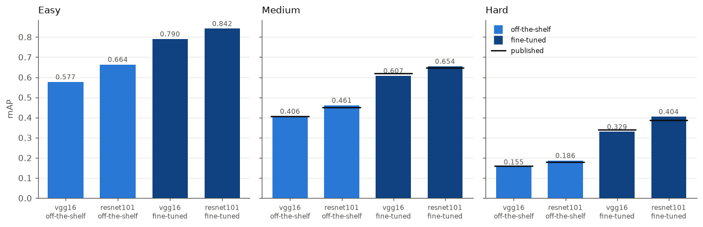
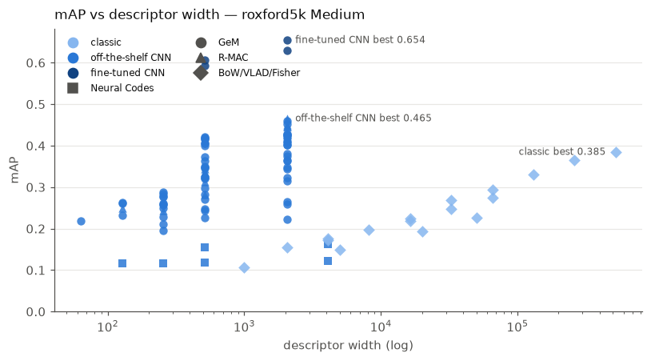
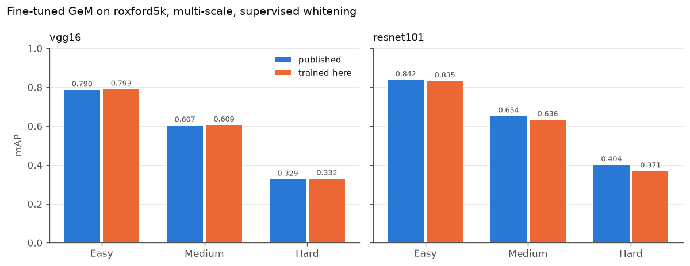
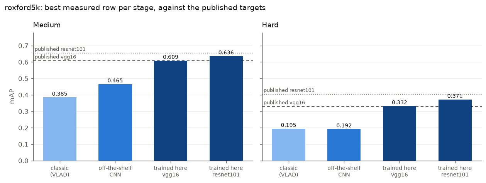
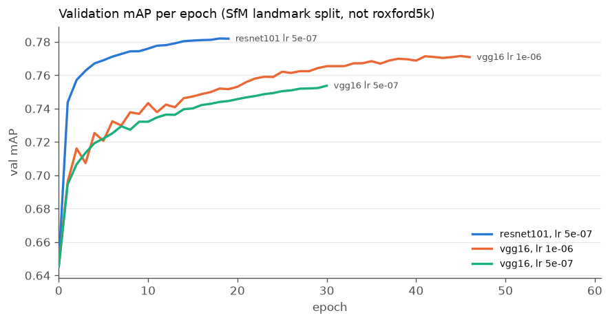

# CNN tier

Part of [image-retrieval](../README.md). Activations of ImageNet CNNs as global descriptors — Neural Codes, SPoC, MAC, R-MAC, GeM — frozen, then fine-tuned for retrieval.

## Results

Frozen ImageNet backbones, plus the published fine-tuned checkpoints in their own
section below. Same protocol as the classic tier:
roxford5k, anything fitted is fitted on rparis6k, seed 0, mAP on 0–1, queries
bbx-cropped, multi-scale at the three published scales (1, 1/√2, 1/2). Published figures
are quoted on the same 0–1 scale; the papers themselves print them ×100.

```
uv run cbir evaluate --dataset roxford5k gem  --backbone resnet101 --p 3.0 \
    --scales 1.0 0.7071067811865476 0.5 --dim 2048 --whiten --weights caffe
uv run cbir evaluate --dataset roxford5k rmac --backbone resnet101 --levels 3 \
    --scales 1.0 0.7071067811865476 0.5 --dim 2048 --whiten --weights caffe
```

## Weight provenance is not a detail

"ImageNet-pretrained ResNet101" is not one object. `cnnimageretrieval` builds a
torchvision architecture and fills it with **Caffe-converted** ImageNet weights; we
started with torchvision's. Same architecture, same dataset, same task, different
training recipe — and the descriptors agree at cosine 0.23.

| GeM `p=3` | torchvision | caffe | Δ |
|---|---:|---:|---:|
| **ResNet101** | 0.347 | **0.461** | **+0.114** |
| ResNet50 | 0.408 | 0.425 | +0.017 |
| VGG16 | 0.420 | 0.406 | −0.014 |

It is architecture-specific, not a blanket improvement: torchvision's ResNet101 simply
transfers to retrieval far worse than its ResNet50, and on VGG16 the Caffe weights are
slightly *worse*. MAC is affected most (+0.162 on ResNet101, +0.080 on ResNet50), which
fits the measured difference in the features — Caffe's final conv map is **96% zeros at
std 0.72** against torchvision's **75% at 0.33**, a sparser, higher-contrast
representation where a max picks a real peak rather than diffuse activation.

The 53× difference in conv1 weight scale is *not* the cause: BatchNorm follows conv1 and
its `running_var` ratio (3392) matches that scale squared (2819), so it divides straight
back out. Nor is it channel order — per-filter matching is worse under BGR than RGB. The
two networks simply learned different features.

This cost six wrong hypotheses. Every one assumed the backbone was a fixed input and
looked for the bug downstream; the published table disagreeing with our measurement was
pointing at the input the whole time.

## Validation against the reference table

Radenović et al. ([1803.11285](https://arxiv.org/abs/1803.11285), Table 5), matching
their configuration — their weights, their truncation:

| method | backbone | ours | published | |
|---|---|---:|---:|---|
| GeM `p=3` | VGG16 | 0.405 / 0.155 | 0.405 / 0.157 | exact |
| GeM `p=3` | ResNet101 | 0.461 / 0.186 | 0.450 / 0.177 | above |
| MAC | ResNet101 | 0.427 / 0.172 | 0.417 / 0.180 | above |
| MAC | AlexNet | 0.276 / 0.090 | 0.283 / 0.088 | −0.7 |
| R-MAC | ResNet101 | 0.465 / 0.142 | 0.498 / 0.185 | **−3.2** |

**VGG16 reproduces exactly** once the configuration matches. Our earlier 0.420 was not a
better reproduction — it was a *different* configuration (torchvision weights, trailing
max-pool kept) that happens to score 0.015 higher than the method it was compared
against.
Both differences pushed the same way.

**R-MAC is the one row still short, with an identified cause**: the published method
PCA-whitens each *region* vector before summing them, while ours whitens the finished
descriptor. Whitening after the sum cannot undo the correlation the sum compounded.
Closing it needs a projection fitted on region vectors — permitted by the cross-dataset
rule, but deliberately not built: the cause is identified and the row is annotated, which
is worth more than a closed gap whose closing taught nothing.

## VGG's trailing max-pool

The reference builds VGG as `features[:-1]`, dropping the final max-pool; we kept it.
That is 4× the positions on the conv map — 64×64 against 32×32 at `max_side=1024`.

| vgg16 GeM `p=3` | pool kept | pool dropped |
|---|---:|---:|
| torchvision weights | 0.420 / 0.156 | 0.416 / **0.167** |
| caffe weights | 0.406 / 0.154 | 0.405 / 0.155 |

Small on Medium, but dropping it is worth **+0.011 Hard** on torchvision weights — more
positions to pool over helps most where the object is small or partly occluded.

## The full grid

All backbones on **torchvision** weights, whitened at native width, so the columns are
comparable to each other. The two ResNet rows that Caffe weights change materially are
noted underneath.

| backbone | dim | SPoC | MAC | GeM `p=3` | R-MAC |
|---|---:|---|---|---|---|
| AlexNet¹ | 256 | 0.210 / 0.025 | 0.276 / 0.090 | 0.279 / 0.072 | 0.244 / 0.041 |
| VGG16 | 512 | 0.372 / 0.109 | 0.349 / 0.137 | **0.420** / 0.156 | 0.344 / 0.073 |
| VGG19 | 512 | 0.347 / 0.100 | 0.346 / 0.151 | 0.400 / **0.184** | 0.336 / 0.065 |
| ResNet18 | 512 | 0.323 / 0.063 | 0.226 / 0.070 | 0.282 / 0.081 | 0.313 / 0.051 |
| ResNet34 | 512 | 0.324 / 0.059 | 0.243 / 0.065 | 0.298 / 0.068 | 0.336 / 0.067 |
| ResNet50 | 2048 | 0.429 / 0.142 | 0.322 / 0.111 | 0.408 / 0.140 | 0.451 / 0.127 |
| ResNet101 | 2048 | 0.381 / 0.102 | 0.265 / 0.067 | 0.347 / 0.108 | 0.428 / 0.111 |
| **ResNet101 (caffe)** | 2048 | 0.419 / 0.136 | 0.427 / 0.172 | 0.461 / **0.186** | **0.465** / 0.142 |
| *(VLAD k=4096, classic)* | *524288* | | | *0.385 / 0.195* | |

¹ AlexNet unwhitened — whitening costs mAP at 256-D.

**Best: ResNet101 R-MAC 0.465 Medium** from 2048 dimensions, against the classic tier's
best of VLAD k=4096 at 0.385 from **524288**. Hard is now close too — 0.186 against
VLAD's 0.195, where it used to be a rout.

**Which pooling wins is backbone-dependent.** GeM leads on VGG; the sum-like poolings
lead on the torchvision ResNets. Note the earlier claim that "MAC is worst on every
ResNet" was an artifact of the wrong weights: on Caffe ResNet101 it is second-best and
has the tier's second-best Hard.

**Depth buys little at fixed width.** ResNet18 → ResNet34 gains ~0.017 averaged over
methods; VGG16 → VGG19 loses Medium and gains Hard. The 512 → 2048 width jump is worth
far more, and weight provenance more than either.

## Whitening

Fitted on the held-out benchmark unless a row says otherwise. Gains sort by how much a
method **sums** rather than **maxes** — summing piles up shared components and whitening
decorrelates them, while a max creates no such correlation.

| VGG16, multi-scale | plain | + whitening | gain |
|---|---:|---:|---:|
| SPoC | 0.271 | 0.372 | **+0.102** |
| R-MAC | 0.282 | 0.344 | +0.062 |
| GeM `p=3` | 0.364 | 0.420 | +0.056 |
| MAC | 0.320 | 0.349 | +0.029 |

It reverses on AlexNet, where whitening costs MAC 0.033 mAP (0.229 → 0.196 single-scale) —
at 256-D there is little redundancy to remove and a proportionally noisier tail. Worth
measuring per backbone rather than assuming.

**`--shrinkage ε`** floors whitening's divisor at `sqrt(λ + ε·mean(λ))`. Whitening
divides by `sqrt(λ)`, and when the fitting set is not much larger than the descriptor the
smallest eigenvalues are noise. At 2048 components fitted on 2100 images the pipeline
scores **0.067** unshrunk and **0.393** at ε=0.1. In the regime we actually run (6322
images) it is worth +0.004 to +0.010 on the 2048-D backbones and +0.001 on VGG16 at
512-D.

**`--whiten-source sfm30k|sfm120k`** fits whitening on the retrieval-SfM landmark corpus
the reference uses (a 40.5 GB manual download; see [usage](usage.md#the-sfm-120k-corpus)). Worth +0.023
Medium on *torchvision* ResNet101 — but once the weights are right it stops helping
(0.461 → 0.453), so that gain was whitening compensating for weak features. It saturates
by ~30k images: 30k and 120k differ by 0.002.

## Fine-tuned checkpoints

Everything above is a frozen ImageNet classifier: optimized to tell a golden retriever
from a poodle, and useful for retrieval only because the features happen to transfer.
Radenović et al. also publish the same architectures **fine-tuned for retrieval itself**,
on retrieval-SfM-120k with a contrastive loss over landmark pairs mined by
structure-from-motion. Oxford/Paris overlaps were removed from that corpus, so the
cross-dataset rule holds: nothing was fitted on what it searches.

| backbone | scales | Medium mAP | mP@10 | Hard mAP | mP@10 |
|---|---|---:|---:|---:|---:|
| VGG16 | single | 0.593 | 0.810 | 0.323 | 0.499 |
| VGG16 | multi | 0.607 | 0.823 | 0.329 | 0.510 |
| ResNet101 | single | 0.630 | 0.833 | 0.383 | 0.541 |
| **ResNet101** | **multi** | **0.654** | **0.860** | **0.404** | **0.564** |

Against Table 5, which reports both metrics on both protocols — eight comparisons, not
two, and the paper does not evaluate Easy at all:

| multi-scale | Medium mAP | mP@10 | Hard mAP | mP@10 |
|---|---:|---:|---:|---:|
| VGG16 ours | 0.607 | 0.823 | 0.329 | 0.510 |
| V–[37]–GeM published | 0.619 | 0.827 | 0.337 | 0.510 |
| | −0.012 | −0.004 | −0.008 | **0.000** |
| ResNet101 ours | 0.654 | 0.860 | 0.404 | 0.564 |
| R–[37]–GeM published | 0.647 | 0.847 | 0.385 | 0.530 |
| | **+0.007** | **+0.013** | **+0.019** | **+0.034** |



**This is what the exercise was for.** Every earlier validation point sat at the bottom
of the published range, 0.40–0.46, where a 0.02 discrepancy is hard to read. Reproducing
0.647 confirms the evaluation path at the top of the range as well, so the gaps in the
off-the-shelf grid above are descriptor gaps and not harness gaps.

ResNet101 lands above its published row and VGG16 below its own — opposite directions,
which is not the shape a pipeline error takes. VGG16's Hard mP@10 is exact and its
Medium mP@10 is −0.004, so the top of its ranking matches and the ~0.01 mAP shortfall is in
the tail. One candidate was tested and rejected: matching the reference's resize order
(normalize first, then bilinearly interpolate the tensor, rather than our single bicubic
PIL resize from the original) moved Medium +0.002 and Hard −0.002. The residual is left
unexplained rather than tuned away.

**The pooling was never the problem.** `p` is differentiable and was therefore trained,
not chosen — and it came out at **2.9208** (VGG16) and **2.9033** (ResNet101) against the
hand-picked 3.0 used everywhere above. Training moved it by 3%. The entire ~0.19 mAP gap
between the off-the-shelf and fine-tuned rows is in the conv weights.

A checkpoint carries three things, and loading only the first would silently produce a
plausible wrong number: the conv stack, the trained `p`, and a supervised whitening
fitted on matching pairs after training (`meta['Lw']`, in `ss` and `ms` variants for
single- and multi-scale runs). The last of these means these runs fit **nothing** at
extraction time — there is no held-out pass at all, which is why they are also the
fastest rows in the tier.

```
uv run cbir evaluate --dataset roxford5k gem --backbone resnet101 --weights sfm120k \
    --p learned --scales 1.0 0.7071067811865476 0.5 --whiten --whiten-source learned
```

Checkpoints are a manual download (`retrievalSfM120k-vgg16-gem-b4dcdc6.pth`,
`retrievalSfM120k-resnet101-gem-b80fb85.pth`) into `CBIR_WEIGHTS_ROOT`; see
`descriptors/cnn/finetuned.py`. Only GeM was published — there is no fine-tuned R-MAC
checkpoint, and asking for one is refused rather than silently downgraded.

## Where the tiers stand



Same benchmark, same protocol, best row from each:

| tier | descriptor | dim | Medium | Hard |
|---|---|---:|---:|---:|
| classic | VLAD k=4096 | 524288 | 0.385 | 0.195 |
| off-the-shelf CNN | ResNet101 R-MAC, caffe | 2048 | 0.465 | 0.142 |
| off-the-shelf CNN | ResNet101 GeM `p=3`, caffe | 2048 | 0.461 | 0.186 |
| fine-tuned CNN | ResNet101 GeM, multi-scale | 2048 | **0.654** | **0.404** |

The off-the-shelf tier needs two rows because no single one wins both protocols: R-MAC
takes Medium and GeM takes Hard, and R-MAC's Hard is its weakest result — the
per-region-whitening gap documented above. Either way that tier beats the classic one on
Medium from a vector 256× shorter, while **losing** to it on Hard (0.195 against 0.186).

The fine-tuned row wins both outright: +0.270 Medium and +0.210 Hard over VLAD, at 1/256
the width — because the network was trained for the question being asked instead of
borrowed from a classifier.

That stays true only within the CNN era: a frozen DINOv3 beats this row on both protocols
without any retrieval training — see the [ViT tier](vit.md).

## Neural Codes

| backbone | dim | Medium | Hard |
|---|---:|---:|---:|
| AlexNet fc6 | 4096 | 0.122 | 0.028 |
| AlexNet fc6 + PCA | 256 | 0.117 | 0.025 |
| VGG16 fc6 | 4096 | 0.163 | 0.051 |
| VGG16 fc6 + PCA | 512 | 0.154 | 0.050 |

Losing to everything else is expected. Babenko et al.
([1404.1777](https://arxiv.org/abs/1404.1777)) report the same ordering for codes off an
ILSVRC-trained network — their contribution is that *retraining* on a landmark set fixes
it, and this harness runs frozen networks only. There is no ROxford reference for the
method, so these rows compare only against our own.

## Other findings

**Multi-scale** is worth +0.047 Medium on AlexNet MAC (0.229 → 0.276). Per-scale descriptors
are L2-normalized before combining, then combined by averaging for every method except
GeM, which reuses its own generalized mean (Radenović et al., §Multi-scale) — worth
~0.002 mAP.

**The `p` curve is flat at its top.** On AlexNet, Medium runs 0.210, 0.258, 0.279,
0.287, 0.285, 0.262 for `p` = 1, 2, 3, 4, 5, 10 — the 3–5 span sits inside 0.008,
unresolvable at one seed. Hard rises monotonically with `p` to true max.

**A note on the last digit.** Two runs of one configuration, identical params and an
identical code path, recorded 0.4200 and 0.4211 (VGG16 GeM `p=3`, torchvision). Nothing in
`params` differed and the intervening change was provably a no-op at `shrinkage=0`, so
that 0.0011 is run-to-run nondeterminism in the pipeline itself. **Treat differences
below roughly 0.002 mAP as noise** — which is the empirical version of the caution the `p` sweep
already states. It also means a figure may disagree with a table in its last digit: the
notebooks plot the *most recent* measurement of each configuration, the tables quote the
run they were written against.

Caveats: single seed throughout, and **roxford5k only** — every number here evaluates on
roxford5k with rparis6k as the held-out set, and the reverse direction was deliberately
not run. Nothing here is evidence that a conclusion generalizes to the second benchmark,
and the published tables score rparis6k considerably higher (R–[37]–GeM: 0.647 ROxf
against 0.772 RPar), so these numbers are the harder half of the usual pair rather than a
representative sample of it. Input is capped at `max_side=1024` and never enlarged, except that
scaled inputs are floored at each backbone's conv-stack minimum (63 px AlexNet, 32 px
elsewhere), which can only trigger below full scale.

# Training a network here

Everything above evaluates weights someone else produced. `cbir train` fine-tunes a
backbone on retrieval-SfM-120k with the reference's recipe, and `cbir whiten` fits the
supervised projection that finishes it — so the question stops being "can we score their
checkpoint" and becomes **"can we produce one"**.

```
uv run cbir train --backbone vgg16 --weights caffe --epochs 100 --lr 1e-6
uv run cbir evaluate gem --backbone vgg16 --weights sfm120k --p learned --no-last-pool \
    --scales 1.0 0.7071067811865476 0.5 --whiten --whiten-source learned \
    --checkpoint data/runs/vgg16-gem-margin0.7-lr1e-06-seed0/best.pth
```

Whitening is fitted automatically as the last step of training, so the checkpoint the
command leaves behind is already complete; `cbir whiten` exists to refit one separately.



| multi-scale, supervised whitening | Easy | Medium | Hard |
|---|---:|---:|---:|
| VGG16 published | 0.790 | 0.607 | 0.329 |
| **VGG16 trained here** (45 epochs) | **0.793** | **0.609** | **0.332** |
| | +0.003 | +0.002 | +0.003 |
| ResNet101 published | 0.842 | 0.654 | 0.404 |
| ResNet101 trained here (19 epochs) | 0.835 | 0.636 | 0.372 |
| | −0.006 | **−0.018** | **−0.033** |

**VGG16 reproduces.** All three gaps sit at or inside the 0.002 noise floor documented
below, so the defensible claim is that the two checkpoints are indistinguishable — not
that ours is better.

**ResNet101 does not, and the shortfall is concentrated on Hard.** Two hypotheses, not
yet separated:

* **Undertrained.** Early stopping ended it at epoch 19 against VGG16's 45. The VGG16 run
  is direct evidence this rule stops too early: its epochs 31–45 gained only +0.006
  validation mAP — under the 0.001-per-epoch threshold that ends a run — while gaining
  **+0.007 Medium** on the benchmark. Validation plateaus before the benchmark does.
* **Whitening under-fitted.** The projection is a `D x D` covariance, and ResNet101's
  D is 2048 against VGG16's 512. At 30000 pairs that is 14.6x the width where VGG16 got
  39x. Whitening's largest effect on VGG16 was on Hard (+0.040), which is exactly where
  ResNet101 loses most.

**The second was tested and is real but small.** Refitting on all 180000 available pairs
— 88x the width, matching what the reference has to work with — touches the projection
and leaves the weights alone:

| ResNet101 whitening pairs | Easy | Medium | Hard |
|---|---:|---:|---:|
| 30000 | 0.836 | 0.632 | 0.367 |
| 180000 | 0.835 | **0.636** | **0.372** |
| | −0.001 | +0.004 | +0.004 |

Both gains clear the noise floor, and both are about a fifth of the deficit. **So
undertraining carries the rest.** Early stopping ended ResNet101 at 19 epochs against
VGG16's 45, and the rule that ended it is the one VGG16 showed to be too eager. The
table above already reflects the refit; the retrain is outstanding.

## What each step is worth


Read through held-out PCA instead of its own projection, the *same* trained VGG16 scores
0.569 Medium against 0.609. The supervised projection is worth **+0.033 Medium and
+0.040 Hard** — roughly four times what doubling the learning rate bought — from a
closed-form solve rather than hours of GPU. This is why a checkpoint without one is
treated as half-finished.

Learning rate mattered less, and only because it was wrong to begin with: no VGG16
command was ever published, so 5e-7 had been borrowed from the ResNet101 one. The
reference's own VGG16 default is 1e-6, and correcting it was worth +0.011 Medium.
ResNet101 keeps 5e-7, which *is* published for that backbone.



Validation mAP per epoch for the three runs, from the trackio store the loop writes.
Measured on the held-out SfM landmark split, **not** roxford5k — a different corpus and a
different label definition, so it ranks checkpoints during a run and nothing more. Its
saturation is exactly why it stops runs too early:



## Two bugs this exercise found

**BatchNorm was training on a batch of one.** Images keep their aspect ratios and so
cannot be stacked, meaning each goes through its own forward pass — and `model.train()`
left ResNet101's 104 BatchNorm layers estimating statistics from a single image. Training
and evaluation therefore computed different functions: one image's descriptor had cosine
similarity **0.58** between the two modes. Validation mAP fell from 0.6465 untrained to
0.1545 by the fourth epoch *while the training loss kept falling*. VGG16 has no BatchNorm
and reproduced the published number with this bug present, which is why it survived.
Freezing the statistics restores the equivalence exactly (cosine 1.000000), as the
reference does; the affine parameters stay trainable.

**Early stopping paid for itself immediately.** It caught that divergence at epoch 5
unprompted — a failure mode it was not written for — and saved ~19 hours. On the healthy
runs it ended VGG16 at 46 of 100 and ResNet101 at 19, keeping the best checkpoint in both
cases: the patience counter ignores gains under `min_delta`, but `best.pth` still tracks
every improvement, so stopping early never discards a better model.
