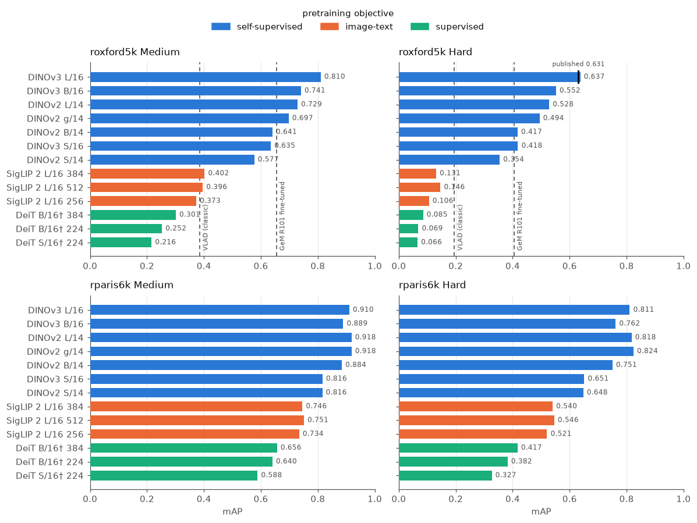
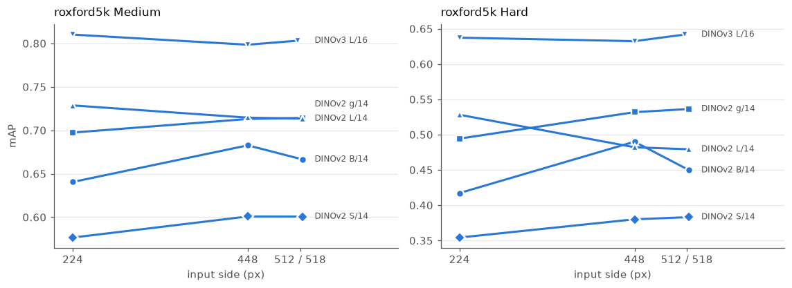
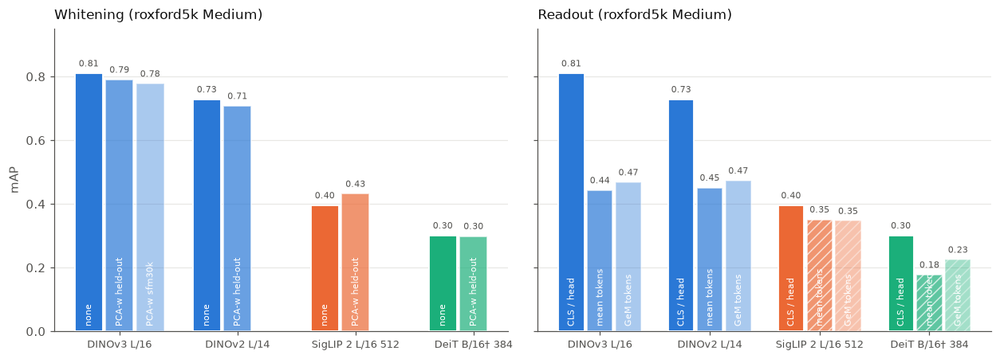
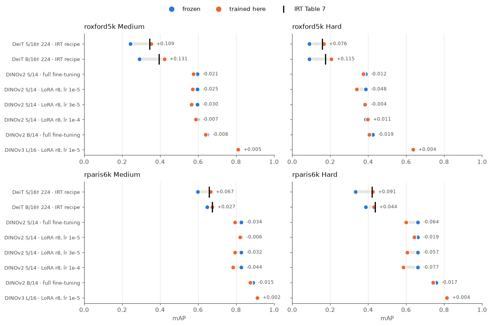
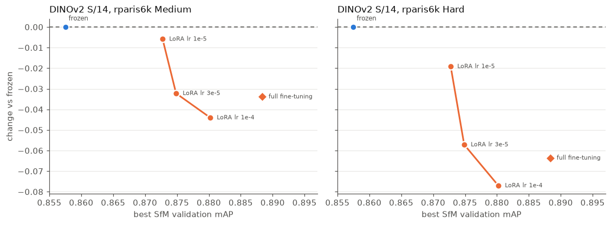

# Transformer tier

Part of [image-retrieval](../README.md). Vision transformers as global descriptors: frozen DINOv2, DINOv3, SigLIP 2 and DeiT, then retrieval training on top (IRT, full fine-tuning, LoRA).

## Results

Frozen vision transformers, each read out by its own image embedding: the CLS token after
the final LayerNorm for DINOv2, DINOv3 and DeiT, the attention-pooling head for SigLIP 2
(which has no CLS token). Compared by cosine. Unless a row says otherwise nothing is
fitted — no PCA, no whitening — so nothing touches the held-out set; the Whitening section
below is the exception. The preprocessing is the one protocol the DINOv3 paper
documents (App. D.8): the longer side resized to 224, the image centred on a black square,
each family normalized as it was trained. Queries are bbx-cropped, as for every other
tier.



Figures in this section and the next come from `notebooks/05_transformers_comparison.ipynb`
and `notebooks/06_transformers_training.ipynb`.

```
uv run cbir evaluate --dataset roxford5k vit --model dinov3-vitl16
uv run cbir evaluate --dataset roxford5k vit --model dinov2-vitl14 --image-size 448
uv run cbir evaluate --dataset rparis6k vit --model siglip2-vitl16-384 --image-size 384
uv run cbir evaluate --dataset roxford5k vit --model siglip2-vitl16-512 --image-size 512 --whiten
uv run cbir evaluate --dataset roxford5k vit --model dinov3-vitl16 --resize aspect --readout gem --p 3.0
```

DINOv3's weights are gated on Hugging Face: accept the license on the
[model page](https://huggingface.co/facebook/dinov3-vitl16-pretrain-lvd1689m) first, or
the download fails with a 403.

| model | dim | roxford5k Medium | roxford5k Hard | rparis6k Medium | rparis6k Hard |
|---|---:|---:|---:|---:|---:|
| DINOv2 ViT-S/14 | 384 | 0.577 | 0.354 | 0.816 | 0.648 |
| DINOv2 ViT-B/14 | 768 | 0.641 | 0.417 | 0.884 | 0.751 |
| DINOv2 ViT-L/14 | 1024 | 0.729 | 0.528 | **0.918** | 0.818 |
| DINOv2 ViT-g/14 | 1536 | 0.697 | 0.494 | **0.918** | **0.824** |
| DINOv3 ViT-S/16 | 384 | 0.635 | 0.418 | 0.816 | 0.651 |
| DINOv3 ViT-B/16 | 768 | 0.741 | 0.552 | 0.889 | 0.762 |
| DINOv3 ViT-L/16 | 1024 | **0.810** | **0.637** | 0.910 | 0.811 |
| SigLIP 2 ViT-L/16, 256 px | 1024 | 0.373 | 0.106 | 0.734 | 0.521 |
| DeiT-S/16†, 224 px | 384 | 0.216 | 0.066 | 0.588 | 0.327 |
| DeiT-B/16†, 224 px | 768 | 0.252 | 0.069 | 0.640 | 0.382 |
| DeiT-B/16†, 384 px | 768 | 0.301 | 0.085 | 0.656 | 0.417 |

DINOv3 ViT-L is the tier's best on roxford5k, 0.081 Medium and 0.109 Hard above DINOv2
ViT-L — and even DINOv3 ViT-B beats DINOv2 ViT-L there. On rparis6k the two generations
are level, DINOv2 slightly ahead.

It is also the first transformer row that reproduces a published number under this
benchmark's protocol: the DINOv3 paper reports 63.1 roxford5k Hard for ViT-L/16, against
0.637 here. That paper says it follows Radenović et al.'s protocol, and the match suggests
it cropped its queries — unlike the DINOv2 paper (below).

Against the other tiers, on roxford5k Medium / Hard:

| tier | best row | Medium | Hard |
|---|---|---:|---:|
| classic | VLAD k=4096 | 0.385 | 0.195 |
| off-the-shelf CNN | ResNet101 R-MAC, caffe, whitened | 0.465 | 0.142 |
| off-the-shelf CNN | ResNet101 GeM `p=3`, caffe, whitened | 0.461 | 0.186 |
| fine-tuned CNN | ResNet101 GeM, Radenović et al.'s published checkpoint | 0.654 | 0.404 |
| fine-tuned CNN | ResNet101 GeM, trained here (19 epochs) | 0.636 | 0.372 |
| frozen supervised ViT | DeiT-B/16†, 384 px | 0.301 | 0.085 |
| fine-tuned ViT | DeiT-B/16†, 224 px, IRT recipe, trained here (stretch) | 0.422 | 0.207 |
| frozen vision-language | SigLIP 2 ViT-L/16, 512 px, whitened | 0.432 | 0.189 |
| frozen self-supervised | DINOv3 ViT-L/16, 224 px | **0.810** | **0.637** |

Each row is that tier's best post-processing: the off-the-shelf CNN and SigLIP 2 rows are
PCA-whitened, the fine-tuned CNN rows use their supervised projection, and the DINO row is
not whitened, because whitening costs DINO points (see below).

A frozen self-supervised network beats the CNN fine-tuned for this very task — the
published checkpoint — by 0.156 Medium and 0.233 Hard, and the one trained here by 0.174
and 0.265. A frozen image-text network of the same size, whitened, only draws
level with the off-the-shelf CNN and with VLAD: SigLIP 2 is trained to say *what* a
picture shows, and this benchmark asks *which* building it is. Unwhitened it sits about 7
points below the DINOv3 paper's SigLIP 2 ViT-L (21.4 Hard), whitened about 2.5; that
paper does not say how it fed SigLIP, so the gap is unexplained rather than attributed.

DeiT is the same ViT architecture trained as a supervised ImageNet classifier (distilled
from a CNN teacher, hence †) — the transformer counterpart of the CNN tier's ImageNet
ResNets, and the checkpoints the IRT recipe fine-tunes. Frozen, it is the weakest row in
the project, below VLAD: a classifier's CLS token describes the *class*, and every image
here is a building. It is the "before" row for retrieval fine-tuning, not a contender.
Low enough to look like a bug, so it was checked against the DINO paper's supervised
ViT-S/16 (33.5 / 8.9 roxford5k, 63.0 / 37.2 rparis6k, measured with uncropped queries):
run the same way through `scripts/dinov2_uncropped_queries.py`, DeiT-S† gives 31.8 / 13.3
and 60.8 / 34.1 — within a few points despite being the distilled checkpoint rather than
theirs. Between that protocol and this one it moves 0.102 roxford5k Medium, against
0.110 for DINOv2-S under the same comparison — the crop's toll on a small model again.

## Resolution



224 px is low for a landmark that fills part of a 1024-px photograph, so the DINO and
SigLIP 2 models were also run larger (DeiT's two sizes are in the table above). SigLIP 2 ships one checkpoint per resolution, so its rows are three
networks; the DINO rows are one network fed differently.

| model | size | roxford5k M / H | rparis6k M / H |
|---|---:|---|---|
| DINOv2 ViT-S/14 | 224 / 448 / 518 | 0.577 / 0.354 · 0.601 / 0.380 · 0.601 / 0.383 | 0.816 / 0.648 · 0.831 / 0.663 · 0.828 / 0.658 |
| DINOv2 ViT-B/14 | 224 / 448 / 518 | 0.641 / 0.417 · 0.683 / 0.490 · 0.667 / 0.450 | 0.884 / 0.751 · 0.889 / 0.759 · 0.887 / 0.757 |
| DINOv2 ViT-L/14 | 224 / 448 / 518 | 0.729 / 0.528 · 0.715 / 0.482 · 0.714 / 0.479 | 0.918 / 0.818 · 0.919 / 0.825 · 0.919 / 0.825 |
| DINOv2 ViT-g/14 | 224 / 448 / 518 | 0.697 / 0.494 · 0.713 / 0.532 · 0.714 / 0.536 | 0.918 / 0.824 · 0.924 / 0.838 · 0.923 / 0.836 |
| DINOv3 ViT-L/16 | 224 / 448 / 512 | 0.810 / 0.637 · 0.798 / 0.632 · 0.803 / 0.642 | 0.910 / 0.811 · 0.911 / 0.813 · 0.913 / 0.816 |
| SigLIP 2 ViT-L/16 | 256 / 384 / 512 | 0.373 / 0.106 · 0.402 / 0.131 · 0.396 / 0.146 | 0.734 / 0.521 · 0.746 / 0.540 · 0.751 / 0.546 |

There is no single direction. Resolution helps DINOv2 ViT-S, B and g on roxford5k (B by
0.073 Hard), *hurts* DINOv2 ViT-L (0.528 → 0.482 Hard), and leaves DINOv3 ViT-L flat
within a point. rparis6k barely moves for anyone. 448 and 518 differ by at most 0.04, and
518 is never clearly better. The protocol's 224 costs neither ViT-L anything — and with 70
queries per dataset, differences of one or two points are near what this benchmark can
resolve.

## Whitening

The off-the-shelf CNN rows are all PCA-whitened, so the same fit was tried on the
transformers: on the held-out benchmark at full width, as those rows are, and on sfm30k
for DINOv3.

| model | whitened on | roxford5k M / H | gain | rparis6k M / H | gain |
|---|---|---|---|---|---|
| DINOv3 ViT-L/16 | held-out | 0.791 / 0.611 | −0.020 / −0.026 | 0.904 / 0.803 | −0.007 / −0.008 |
| DINOv3 ViT-L/16 | sfm30k | 0.778 / 0.593 | −0.032 / −0.044 | 0.907 / 0.804 | −0.004 / −0.007 |
| DINOv2 ViT-L/14 | held-out | 0.708 / 0.499 | −0.021 / −0.029 | 0.911 / 0.802 | −0.007 / −0.016 |
| DeiT-B/16†, 384 px | held-out | 0.299 / 0.081 | −0.002 / −0.005 | 0.661 / 0.427 | +0.004 / +0.010 |
| SigLIP 2 ViT-L/16, 512 px | held-out | 0.432 / 0.189 | +0.036 / +0.042 | 0.821 / 0.652 | +0.069 / +0.107 |

Whitening **hurts** both DINO generations, and it is not a noisy covariance: fitted on
sfm30k, five times more images, DINOv3 loses more, not less. Self-distillation already
spreads its features; whitening then inflates directions that are weak for a reason.
SigLIP 2 gains up to 0.107 — the CNN tier's pattern again, where whitening pays most for
descriptors whose dimensions share structure, and an image-text embedding is dominated by
broad semantic directions. DeiT does not move.

## CLS against pooled patch tokens



The patch grid is a transformer's counterpart of a conv map, so the CNN tier's pooling
applies to it directly: `--readout mean` averages the patch tokens (SPoC over tokens),
`--readout gem --p 3.0` takes their generalized mean. The prefix tokens — CLS, DINOv3's
four registers, DeiT's distillation token — are excluded, and every batch checks that
what is left is exactly the patch grid.

| model | readout | `pad` roxford5k M / H | `aspect` roxford5k M / H | `aspect` rparis6k M / H |
|---|---|---|---|---|
| DINOv3 ViT-L/16 | CLS | **0.810 / 0.637** | 0.800 / 0.614 | 0.907 / 0.806 |
| DINOv3 ViT-L/16 | mean | 0.345 / 0.190 | 0.443 / 0.224 | 0.797 / 0.640 |
| DINOv3 ViT-L/16 | GeM `p=3` | 0.361 / 0.202 | 0.468 / 0.250 | 0.811 / 0.652 |
| DINOv2 ViT-L/14 | CLS | 0.729 / 0.528 | 0.716 / 0.520 | 0.918 / 0.816 |
| DINOv2 ViT-L/14 | mean | 0.320 / 0.150 | 0.451 / 0.205 | 0.800 / 0.641 |
| DINOv2 ViT-L/14 | GeM `p=3` | 0.326 / 0.140 | 0.473 / 0.197 | 0.796 / 0.624 |

**The padding is a trap for pooled readouts.** Under `pad`, the black bars are patches,
and a mean averages them in: a quarter of a 4:3 photo, more than half of a narrow query
crop. Removing them (`aspect`) is worth 0.10–0.15 roxford5k Medium to the pooled
readouts and nothing to CLS, which attends past them. So pooled rows must be measured
under `aspect`; the `pad` ones are recorded but understate pooling.

Even so, **CLS wins by a wide margin**: 0.800 against 0.468 for DINOv3 without padding.
DINO's patch tokens are trained for dense tasks; the image-level summary is what CLS
learns. GeM edges out the mean despite its clamp discarding the tokens' negative half.

DeiT and SigLIP 2 cannot run unpadded — their position embeddings fix a square input — so
their pooled rows are confounded by the bars and no conclusion is drawn from them (both
are lower than their native readouts: DeiT 0.178 mean and 0.225 GeM against 0.301 CLS,
SigLIP 2 0.351 and 0.347 against 0.396 on roxford5k Medium).

## The DINOv2 paper uses a different protocol

These rows sit below the DINOv2 paper's Table 9 — far below for the small models on
roxford5k (ViT-S 0.577 / 0.354 against a published 0.688 / 0.432) — because the paper
evaluates differently. It does not state its protocol, but its numbers match the DINO
group's public [`eval_image_retrieval.py`](https://github.com/facebookresearch/dino),
which loads each query image whole and never applies its `bbx`. The benchmark's labels
describe the crop, so this project keeps cropping, and Table 9 is not directly comparable
to anything here.

`scripts/dinov2_uncropped_queries.py` replicates that script outside the harness — it
writes nothing to `results/` — and lands within 0.1–1.6 mAP of Table 9 for ViT-S, B and L
on both datasets, which is what pins the difference on the protocol rather than on this
implementation. Changing padding, interpolation or the centre-crop transform did not
close the gap (those runs are recorded, `--resize aspect|crop`, `--interpolation`).

## Training a transformer here (IRT)

The trainable half starts with IRT (El-Nouby et al. 2021,
[2102.05644](https://arxiv.org/abs/2102.05644)): the GeM recipe of the [CNN tier](cnn.md#training-a-network-here) with the backbone
swapped — DeiT for ResNet, CLS for GeM, the same SfM-120k tuples, contrastive loss and
optimizer, margin 0.85, 100 epochs. `cbir train` runs it for any CLS model:

```
uv run cbir train --backbone deit-vits16-dist-224 --epochs 100 --patience None
uv run cbir evaluate --dataset roxford5k vit --model deit-vits16-dist-224 --resize stretch \
    --checkpoint data/runs/deit-vits16-dist-224-cls-margin0.85-lr5e-07-seed0/best.pth
```

IRT squashes every image, training and evaluation alike, "into a square image" — aspect
ratio discarded, no bars. That is `--resize stretch`, a different geometry from the
padded protocol above, so the "before" rows are re-measured under it: frozen DeiT-B† 384
scores 0.349 Medium here against 0.301 padded. Comparing a trained row to the padded one
would credit training with five points the geometry earned.

| DeiT†, CLS, `stretch` | ROxf M | ROxf H | RPar M | RPar H |
|---|---:|---:|---:|---:|
| S† 224, frozen | 0.243 | 0.090 | 0.598 | 0.333 |
| **S† 224, trained here** | **0.352** | **0.166** | **0.666** | **0.424** |
| S† 224, IRT Table 7 | 34.5 | 15.8 | 65.8 | 42.0 |
| B† 224, frozen | 0.291 | 0.091 | 0.647 | 0.386 |
| **B† 224, trained here** | **0.422** | **0.207** | **0.674** | **0.430** |
| B† 224, IRT Table 7 | 39.5 | 17.4 | 67.5 | 43.6 |



**IRT reproduces.** S† lands within 0.8 of the paper on all four numbers, and B† within
0.6 on rparis6k. B† is 2.7 / 3.3 *above* the paper on roxford5k: larger than S†'s gaps,
but in the direction a harness bug rarely produces, from the same code that matched
everywhere else, on a 70-query benchmark from one seed each side. Recorded as a gap, not
attributed; a second seed would say whether it is noise.

Training lifts roxford5k by 11–13 Medium and rparis6k by 3–7, and neither run had
finished improving: validation mAP on SfM rose for all 100 epochs (S† 0.643 → 0.802, B†
0.702 → 0.824), flattening only at the end. Early stopping is off for these runs, which
is what the ResNet101 run in the [CNN tier](cnn.md#training-a-network-here) argues for.

PCA-whitening fitted on SfM-120k *lowers* the trained S† (roxford5k 0.338 / 0.134,
rparis6k 0.643 / 0.402), so the rows are raw CLS. The paper uses PCA only to reduce to
128 dimensions.

Not run: B† 384 (IRT's headline row, 50.5 / 22.7) and IRT_R's entropy regularizer. Both
are DeiT, and the best IRT row still sits ~25 Medium below frozen DINOv3-L — the
reproduction is settled by the two rows above, and the open question is DINO's.

**Next: the same recipe on DINOv2.** Two measurements set it up. First, the "before"
rows under `stretch` — which, as for DeiT, scores slightly above the padded protocol:

| frozen, CLS, 224 | ROxf M | ROxf H | RPar M | RPar H |
|---|---:|---:|---:|---:|
| DINOv2-S/14, `stretch` | 0.596 | 0.387 | 0.827 | 0.662 |
| DINOv2-S/14, `pad` | 0.577 | 0.354 | 0.816 | 0.648 |
| DINOv2-B/14, `stretch` | 0.648 | 0.424 | 0.888 | 0.759 |
| DINOv2-B/14, `pad` | 0.641 | 0.417 | 0.884 | 0.751 |

Second, how much of the training objective each frozen model already solves — mAP on the
SfM validation split, the number every training run logs as epoch 0
(`scripts/sfm_validation.py`):

| model | SfM val mAP |
|---|---:|
| DeiT-S† 224, frozen → trained here | 0.643 → 0.802 |
| DeiT-B† 224, frozen → trained here | 0.702 → 0.824 |
| DINOv2-S/14, frozen | 0.858 |
| DINOv2-B/14, frozen | 0.887 |
| DINOv2-L/14, frozen | 0.905 |
| DINOv3-L/16, frozen | 0.928 |

Frozen DINOv2-S already starts above where 100 epochs of IRT leave DeiT-B†. The recipe has
far less room on DINO than it had on DeiT — and what room there is does not reach the
benchmark. **Full fine-tuning makes DINOv2 worse:**

| DINOv2, CLS, 224, `stretch` | ROxf M | ROxf H | RPar M | RPar H |
|---|---:|---:|---:|---:|
| S/14 frozen | 0.596 | 0.387 | 0.827 | 0.662 |
| S/14 IRT recipe, trained here (best epoch 38) | 0.575 | 0.375 | 0.793 | 0.599 |
| | −0.021 | −0.012 | −0.034 | −0.064 |
| B/14 frozen | 0.648 | 0.424 | 0.888 | 0.759 |
| B/14 IRT recipe, trained here (best epoch 48) | 0.640 | 0.405 | 0.874 | 0.742 |
| | −0.008 | −0.019 | −0.015 | −0.017 |

SfM validation peaked early (S 0.857 → 0.888 at epoch 38, B 0.887 → 0.909 at epoch 48) and
then slid while the training loss kept falling — the network fitting SfM's tuples — and
`best.pth` is the validation peak, so these rows are the recipe at its best. Even so, the
SfM gain does not transfer to Oxford and Paris. The bigger model loses less. Retrieval
training that rewrites every weight overwrites more of what 142M-image pretraining learned
than SfM-120k can teach back — which is the case for LoRA, next.

**LoRA does not rescue it.** Rank-8 adapters on the attention projections, pretrained
weights frozen (`--lora-rank 8 --lr …`), 15 epochs per learning rate on DINOv2-S:

| DINOv2-S/14, 224, `stretch` | best SfM val | ROxf M | ROxf H | RPar M | RPar H |
|---|---:|---:|---:|---:|---:|
| frozen | 0.857 | **0.596** | 0.387 | **0.827** | **0.662** |
| LoRA, lr 1e-5 | 0.873 | 0.571 | 0.339 | 0.821 | 0.643 |
| LoRA, lr 3e-5 | 0.875 | 0.566 | 0.383 | 0.795 | 0.605 |
| LoRA, lr 1e-4 | 0.880 | 0.589 | **0.398** | 0.783 | 0.585 |
| full fine-tuning | 0.888 | 0.575 | 0.375 | 0.793 | 0.599 |

Every run gains on SfM validation and loses on rparis6k. Across the three LoRA learning
rates the bigger SfM gain is the bigger loss (Hard 0.643 → 0.605 → 0.585); full
fine-tuning gains most on SfM without losing most, so the ordering holds within LoRA, not
across methods. roxford5k is noisier, and its one cell above frozen (lr 1e-4, Hard
+0.011) comes with Medium below it.

 Selecting the learning rate on SfM
validation, as the protocol requires, picks 1e-4: the worst LoRA row on rparis6k. **For
DINO, SfM validation points the wrong way.** All three rows are recorded, not just the
selected one, because that is the finding.

One short check on the tier's best model — DINOv3-L/16, LoRA rank 8, lr 1e-5 (the gentlest
setting above, *not* selected on SfM), 15 epochs:

| DINOv3-L/16, 224, `stretch` | ROxf M | ROxf H | RPar M | RPar H |
|---|---:|---:|---:|---:|
| frozen | 0.806 | 0.632 | 0.910 | 0.810 |
| LoRA, best SfM epoch (2 of 15) | 0.811 | 0.636 | 0.912 | 0.815 |

SfM validation peaked at epoch 2 (0.9279 → 0.9285) and fell every epoch after, so the kept
checkpoint is two epochs from frozen, and its +0.002–0.005 is at the noise floor. The
recipe has nothing to teach DINOv3-L that SfM itself rewards past the second epoch.

**Conclusion for the trainable half: on this recipe and this data, retrieval training adds
nothing to DINO** — full fine-tuning and LoRA alike, at every size tried. It lifts a
supervised DeiT by 10+ points and reproduces IRT, but self-supervised pretraining already
sits past where SfM-120k can take a network, and moving further toward SfM moves away from
Oxford and Paris.

Batching is what makes 100 epochs affordable: square inputs stack, so mining and
validation run 64 images per forward and a tuple goes through as one, with JPEG decoding
in DataLoader workers. An S† epoch takes ~125 s (B† ~175 s) instead of ~11 minutes, and
tests pin that the descriptors and the loss are the ones one-image-per-forward gives.
